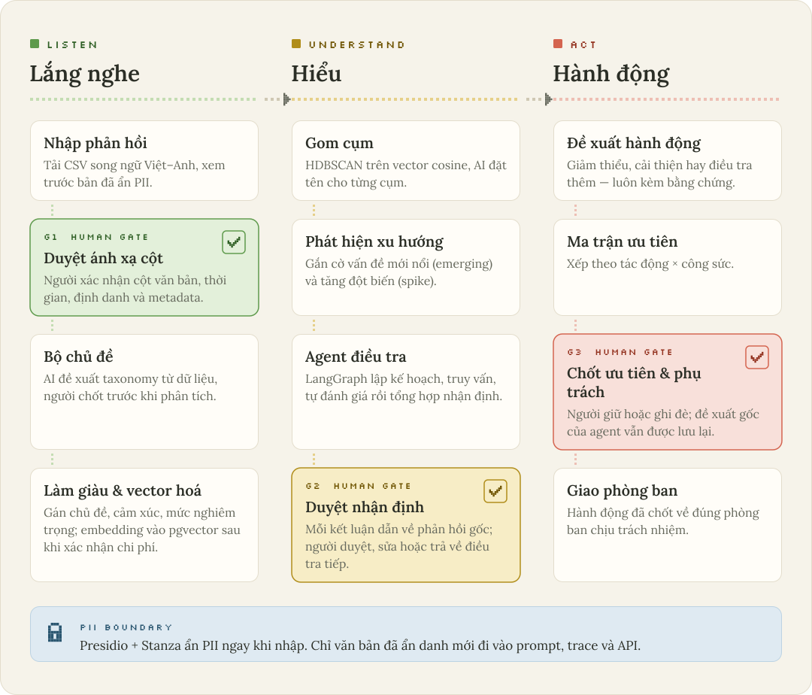

<p align="center">
  
</p>

<p align="center">
  <a href="#happynest-là-gì">Giới thiệu</a>
  &nbsp;·&nbsp;
  <a href="#cách-hoạt-động">Cách hoạt động</a>
  &nbsp;·&nbsp;
  <a href="#công-nghệ">Công nghệ</a>
  &nbsp;·&nbsp;
  <a href="#chạy-trên-máy">Chạy trên máy</a>
  &nbsp;·&nbsp;
  <a href="#tài-liệu">Tài liệu</a>
</p>

> **Khóa luận tốt nghiệp** — *AI Agent tổng hợp, phân loại và phát hiện vấn đề từ phản hồi người dùng về sản phẩm AI.*
> <br><sub>An AI agent that turns bilingual Vietnamese–English product feedback into evidence-backed insights, with a person approving every step that matters.</sub>

## Happynest là gì?

Đội làm sản phẩm AI nhận phản hồi từ nhiều kênh, viết lẫn tiếng Việt và tiếng Anh, và phần lớn không ai đọc hết. Happynest gom phản hồi về một chỗ, ẩn thông tin cá nhân, phân loại theo bộ chủ đề do chính đội duyệt, gom cụm để thấy vấn đề lặp lại hay vừa nổi lên, rồi để một agent điều tra viết nhận định có dẫn chứng. Nhận định chỉ trở thành việc cần làm khi có người duyệt.

<table>
  <tr>
    <td width="50%" valign="top">
      <b>Song ngữ ngay từ đầu</b><br>
      Dữ liệu trộn Việt–Anh (code-switching) là trường hợp mặc định. Từ bước ẩn PII đến phân loại đều chọn công cụ cho đúng tình huống này.
    </td>
    <td width="50%" valign="top">
      <b>Kết luận nào cũng có bằng chứng</b><br>
      Mỗi nhận định trỏ về đúng các phản hồi đã tạo ra nó. Thiếu bằng chứng hợp lệ thì agent chỉ được đề xuất điều tra thêm.
    </td>
  </tr>
  <tr>
    <td width="50%" valign="top">
      <b>Ba cổng người duyệt</b><br>
      Ánh xạ dữ liệu (G1), nhận định (G2) và hành động (G3) đều dừng lại chờ người. Quyết định của người được lưu cạnh đề xuất gốc của agent.
    </td>
    <td width="50%" valign="top">
      <b>Chi phí và quyền riêng tư rõ ràng</b><br>
      Mỗi lượt phân tích có biên nhận chi phí để xác nhận trước. Chỉ văn bản đã ẩn danh mới đi vào prompt, trace và API.
    </td>
  </tr>
</table>

## Cách hoạt động

<picture>
  <source media="(prefers-color-scheme: dark)" srcset=".github/assets/how-it-works-dark.svg">
  
</picture>

Ba cánh của logo là ba chặng, và cũng là ba nhóm trong thanh điều hướng của ứng dụng. Người dùng đi lại tự do giữa các chặng; hệ thống chỉ gợi ý bước nên làm tiếp.

| Chặng | Màn hình | Kết quả |
|---|---|---|
| 🟩&nbsp;**Lắng&nbsp;nghe** | Nhập dữ liệu · Chủ đề · Kho phản hồi | Phản hồi đã ẩn PII, gắn chủ đề, cảm xúc, mức nghiêm trọng |
| 🟨&nbsp;**Hiểu** | Khám phá · Báo cáo | Cụm vấn đề, cờ mới nổi / tăng đột biến, nhận định kèm bằng chứng |
| 🟥&nbsp;**Hành&nbsp;động** | Ma trận ưu tiên · Phòng ban | Việc cần làm đã chốt ưu tiên và người phụ trách |

## Công nghệ

| Lớp | Công nghệ |
|---|---|
| Giao diện | Next.js 16 · React 19 · Tailwind CSS 4 · shadcn/ui · TanStack Query & Table |
| API | FastAPI · SQLAlchemy 2 · Alembic · JWT trong cookie httpOnly · Argon2 · Google OAuth |
| Dữ liệu | Supabase PostgreSQL · pgvector |
| Agent&nbsp;&&nbsp;ML | LangGraph (checkpoint trên Postgres) · LLM qua API tương thích OpenAI · HDBSCAN (scikit-learn) |
| Quyền&nbsp;riêng&nbsp;tư | Microsoft Presidio · Stanza · spaCy |
| Quan sát | Langfuse (trace theo từng lượt chạy) · Prometheus · Grafana Cloud |

```text
.
├── backend/              FastAPI + agent · uv, Python 3.12
│   ├── app/              api · services · models · jobs · analytics
│   ├── understand_agent/ đồ thị LangGraph của chặng Hiểu
│   ├── alembic/          migration
│   └── tests/            unit + integration (-m integration)
├── frontend/             Next.js 16 · pnpm
├── docs/                 hợp đồng triển khai, decision log, bản thảo khóa luận
├── infra/                Supabase, systemd, observability
└── scripts/spikes/       thí nghiệm S1–S7, lưu làm bằng chứng
```

## Chạy trên máy

Cần sẵn: tài khoản [Supabase](https://supabase.com) (gói miễn phí), Python 3.12 với [uv](https://docs.astral.sh/uv/), Node.js 20+ với [pnpm](https://pnpm.io). Không dùng Docker.

> [!WARNING]
> Project Supabase miễn phí tự tạm dừng sau 7 ngày ít hoạt động. Mỗi tuần mở dashboard hoặc chạy ít nhất một truy vấn, nếu không mọi lệnh dưới đây sẽ lỗi kết nối.

### Lần đầu

```powershell
# 0. Trên Supabase: Dashboard → Connect → Session pooler → chép connection string
#    (dùng cổng 5432; transaction pooler :6543 làm hỏng prepared statement của Alembic)

# 1. Tạo file môi trường từ mẫu rồi điền giá trị thật — không commit file này
Copy-Item .env.example backend\.env

# 2. Backend: cài thư viện, migrate, tạo tài khoản mặc định
cd backend
uv sync
uv run alembic upgrade head          # `uv run alembic current` phải ra "(head)"
uv run python scripts/seed_users.py  # đặt SEED_PM_PASSWORD / SEED_OPS_PASSWORD trước khi chạy

# 3. Frontend
cd ..\frontend
pnpm install
```

### Mỗi ngày

Mở hai terminal tại thư mục gốc và giữ cả hai chạy:

```powershell
# Terminal 1 — API
cd backend
uv run uvicorn app.main:app --reload
```

```powershell
# Terminal 2 — giao diện
cd frontend
pnpm dev
```

| Địa chỉ | Dùng để |
|---|---|
| http://127.0.0.1:3000/landing | Trang giới thiệu, đăng ký và đăng nhập |
| http://127.0.0.1:8000/docs | Swagger UI — bấm *Authorize*, đăng nhập bằng tài khoản đã seed (vd. `pm@thesis.local`) |
| http://127.0.0.1:8000/api/health | Kiểm tra sức khỏe: `{"status":"ok","db":"ok", ...}` |

Mọi tài khoản đăng nhập dùng chung một workspace và toàn bộ chức năng. Hàng đợi nhập liệu và phân tích nằm trong nút **Hoạt động** ở góc phải thanh trên cùng. Tải CSV chỉ tạo bản xem trước miễn phí; ánh xạ bằng AI và phân tích đều có biên nhận và bước xác nhận riêng, nên không tự tiêu credit. Có thể tải lại hoặc chia sẻ URL `?activity=import:<id>` / `?activity=run:<id>` để tiếp tục duyệt.

<details>
<summary><b>Kiểm thử</b></summary>
<br>

| Lệnh (trong `backend/`) | Phạm vi | Cần |
|---|---|---|
| `uv run pytest -q` | Unit thuần, mock LLM / embedder / tracing | Không cần DB hay mạng |
| `uv run pytest -q -m integration` | Integration trên PostgreSQL thật, provider AI vẫn mock | Supabase đang chạy + internet |
| `TEST_DATABASE_URL=… uv run pytest -q -m integration` | Chạy integration trên project Supabase thứ hai (nên dùng khi dữ liệu demo đã quan trọng); cần `alembic upgrade head` một lần trên project đó | Project test đang chạy |

- Không kết nối được DB thì test integration **bỏ qua kèm thông báo**, không báo lỗi.
- Suite integration tự dọn các dòng nó tạo (tiền tố `external_ref` + quarantine), nên chạy an toàn trên DB dev dùng chung.
- Frontend: `pnpm typecheck`, `pnpm lint`, `pnpm test` (Vitest) trong `frontend/`.

</details>

<details>
<summary><b>Quy tắc vận hành</b></summary>
<br>

1. **Không Docker** — FastAPI chạy trực tiếp trên Windows, PostgreSQL do Supabase quản lý.
2. `uvicorn --reload` chạy ở terminal riêng, không gọi từ script khác.
3. **Ranh giới PII** — nội dung thô không bao giờ vào prompt, log, trace, tài liệu hay API response; chỉ `feedback_text` và hồ sơ / mẫu đã làm sạch được ra khỏi biên.
4. `.env.example` ở gốc repo là nguồn duy nhất cho danh sách biến môi trường; code đọc bản `backend/.env`.
5. Mọi thay đổi lệch khỏi kế hoạch được ghi kèm ngày vào [`docs/decisions.md`](docs/decisions.md).

</details>

## Tài liệu

| Tài liệu | Nội dung |
|---|---|
| [`docs/README.md`](docs/README.md) | Hợp đồng triển khai hiện hành, ranh giới cần giữ, thứ tự đọc |
| [`docs/api-checklist.md`](docs/api-checklist.md) | Bản đồ endpoint, xác thực, schema và vị trí trên frontend |
| [`docs/decisions.md`](docs/decisions.md) | Decision log — mọi lệch khỏi kế hoạch |
| [`docs/plan_report.md`](docs/plan_report.md) | Tóm tắt các giai đoạn đã hoàn tất |
| [`docs/plans/00-index.md`](docs/plans/00-index.md) | Việc còn mở |
| [`docs/backend-foundation-report.md`](docs/backend-foundation-report.md) | Kết quả nghiệm thu backend, tư liệu cho khóa luận |
| [`docs/act-best-practices-evaluation.md`](docs/act-best-practices-evaluation.md) | Kiểm tra chặng Hành động: sinh đề xuất, bám bằng chứng, cách trình bày |
| [`docs/google-oauth-setup.md`](docs/google-oauth-setup.md) · [`infra/supabase_setup.md`](infra/supabase_setup.md) | Cài đặt Google OAuth và Supabase |

<br>

<p align="center">
  
  <br>
  <sub><b>Warm intelligence · Calm clarity · Human control</b></sub>
  <br>
  <sub>Khóa luận tốt nghiệp · Lê Đăng Tân · 2026</sub>
</p>
