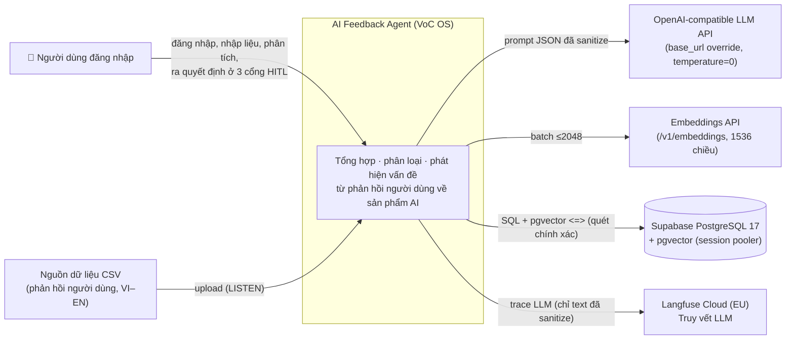
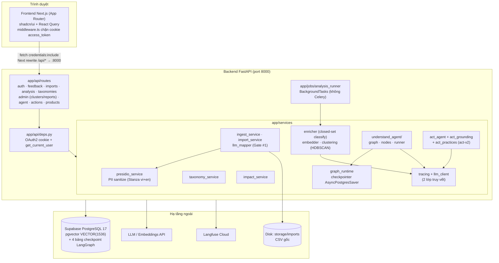

# 1. Sơ đồ tổng thể hệ thống

## 1.1. Sơ đồ bối cảnh (C4 — Level 1: System Context)

Hệ thống tương tác với ai và cái gì ở bên ngoài.

## 1.2. Sơ đồ thành phần (C4 — Level 2: Containers / Components)

## 1.3. Ba lớp chức năng LISTEN → UNDERSTAND → ACT

```mermaid
flowchart LR
    subgraph L["LISTEN — Thu thập & chuẩn hóa"]
        L1["Upload CSV + profile"] --> L2["LLM mapping proposal<br/>✂ CỔNG #1: duyệt mapping"]
        L2 --> L3["Import rows (sanitize PII)"]
        L4["Nhập thủ công POST /feedbacks"] --> L3
    end

    subgraph U["UNDERSTAND — Phân tích & phát hiện vấn đề"]
        U1["Batch classify (closed-set taxonomy)<br/>+ embed 1536d"] --> U2["HDBSCAN cosine<br/>+ naming LLM"]
        U2 --> U3["Trend / Spike / Emerging"]
        U4["Agent LangGraph: planner → tools → evidence → synthesizer"]
        U4 --> U5["✂ CỔNG #2: duyệt insight<br/>(interrupt persist_insight)"]
    end

    subgraph A["ACT — Hành động & đo lường"]
        A1["act_agent: đề xuất theo 8 business function<br/>priority = công thức tất định"]
        A1 --> A2["✂ CỔNG #3: điều chỉnh<br/>human_impact/effort/urgency"]
        A2 --> A3["Impact check<br/>delta_ratio trước/sau"]
    end

    L3 --> U1
    U3 --> U4
    U5 --> A1
    A3 -.->|"vòng lặp đóng KPI"| U1
```

Mọi quyết định tại 3 cổng đều ghi vào `decision_logs` (`agent_value` vs `human_value`) — bộ nhớ quyết định của hệ VoC OS.
