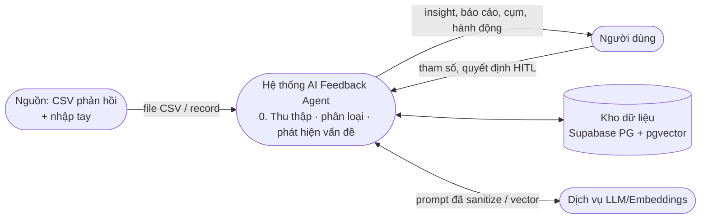
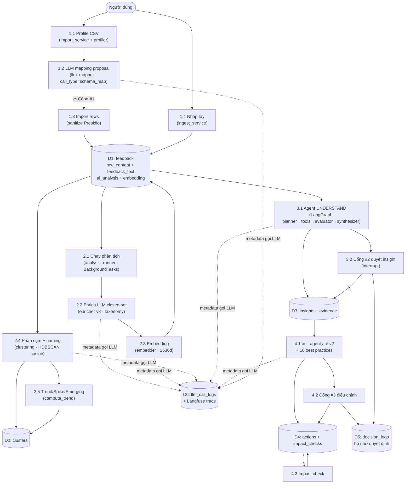
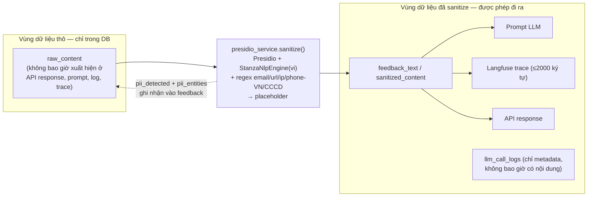

# 2. Sơ đồ luồng dữ liệu (Data Flow)

## 2.1. DFD mức 0 — Bối cảnh

## 2.2. DFD mức 1 — Các tiến trình chính

## 2.3. Ranh giới PII (PII boundary)

Nguyên tắc khóa luận: **nội dung thô không bao giờ ra khỏi ranh giới sanitize**.

- Prompt do con người cung cấp (lý do duyệt/sửa tại Cổng #2, text chỉnh insight) cũng **bắt buộc re-sanitize** trước khi persist (`apply_decision`, `resume_with_decision`).
- `llm_call_logs` chỉ lưu `call_type, prompt_version, model, latency_ms, tokens, error` — không bao giờ lưu prompt/response.
