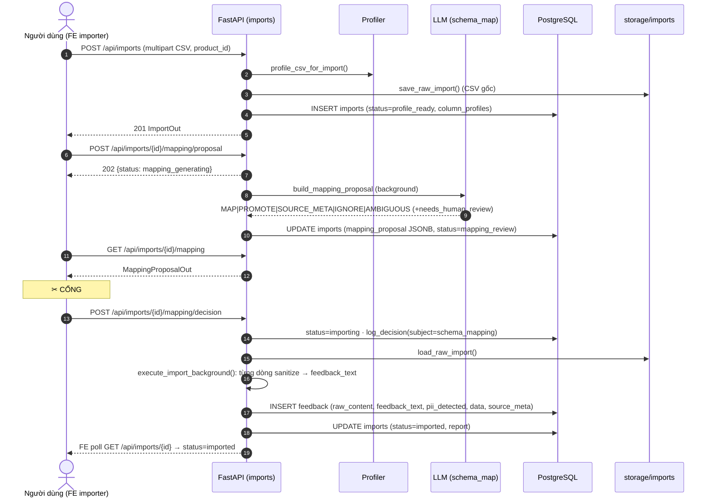
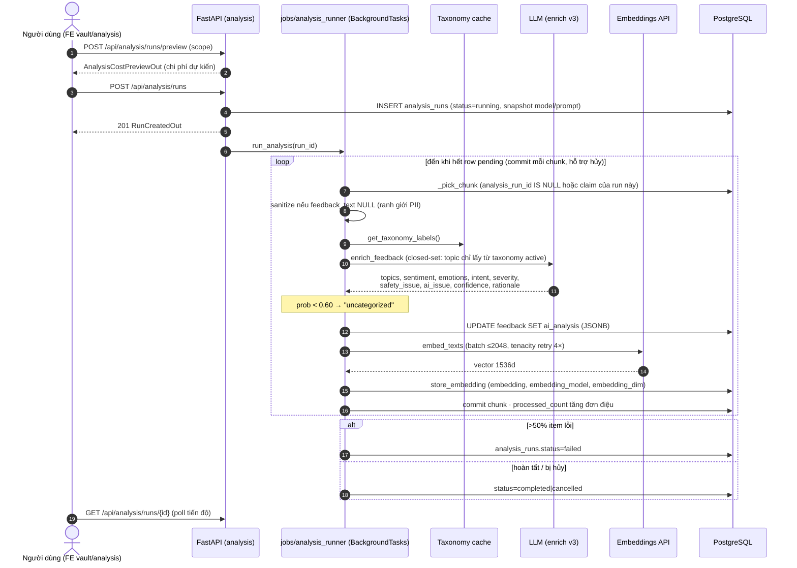
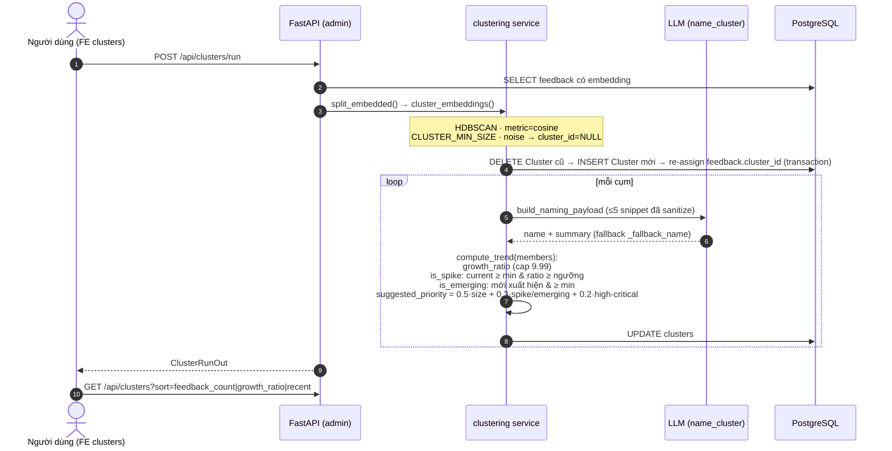
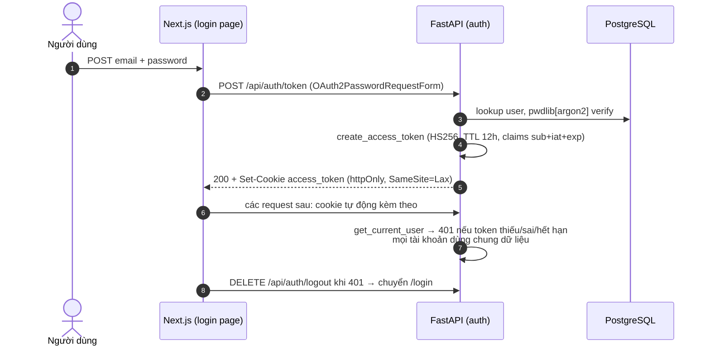

# 3. Sơ đồ trình tự — Nhập liệu, Phân tích, Phân cụm

## 3.1. Nhập CSV + Cổng HITL #1 (duyệt mapping)

## 3.2. Batch phân loại + embedding (analysis_runner v3)

Giai đoạn sau (`POST /api/analysis/re-enrich-uncategorized` + apply taxonomy v2) tạo **vòng lặp tiến hóa taxonomy**: nhãn "uncategorized" được reset, chạy lại enrich với taxonomy mới.

## 3.3. Phân cụm HDBSCAN + trend/spike

## 3.4. Xác thực JWT cookie (điều kiện tiên quyết của mọi trình tự trên)

