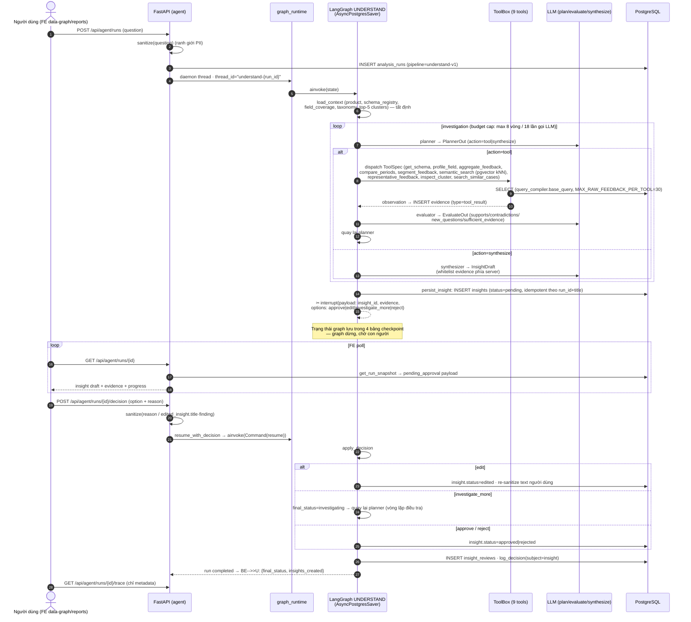
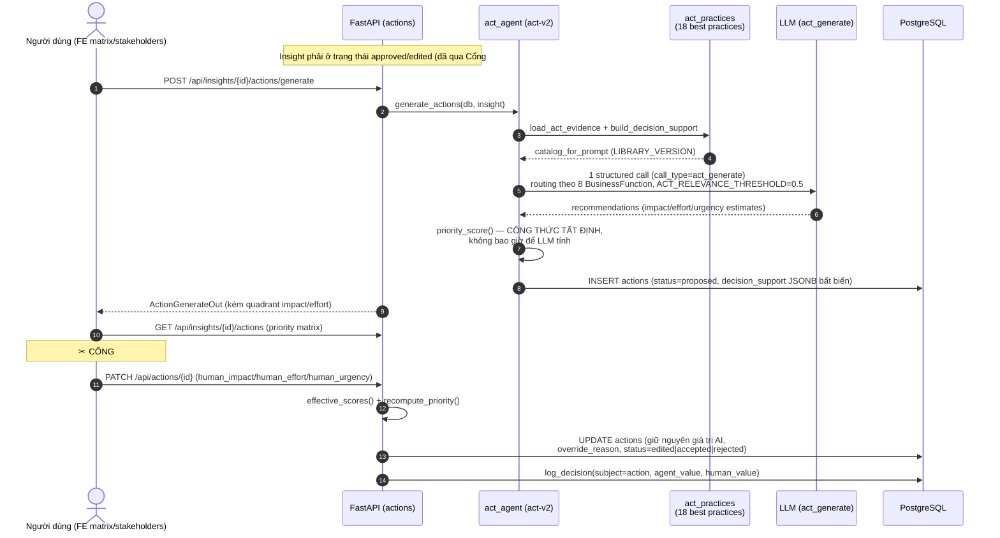
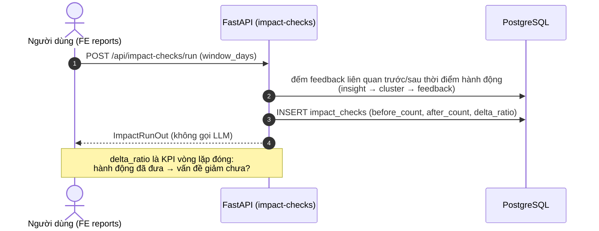

# 4. Sơ đồ trình tự — Agent UNDERSTAND (Cổng #2) & ACT (Cổng #3)

## 4.1. UNDERSTAND agent — LangGraph + interrupt Cổng #2

## 4.2. ACT agent — đề xuất hành động + Cổng #3

## 4.3. Đo tác động (vòng lặp đóng)

