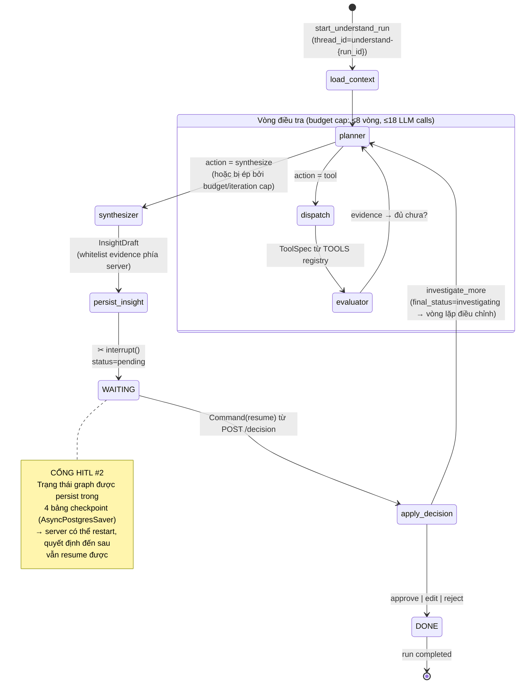
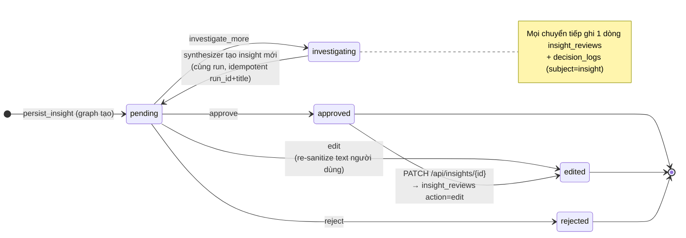
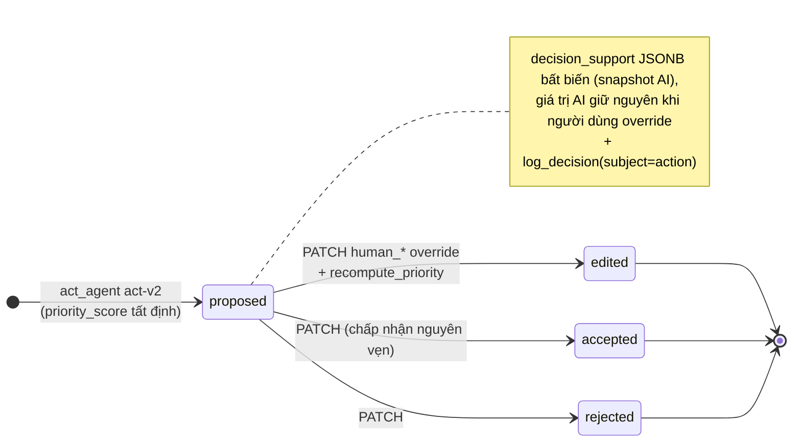
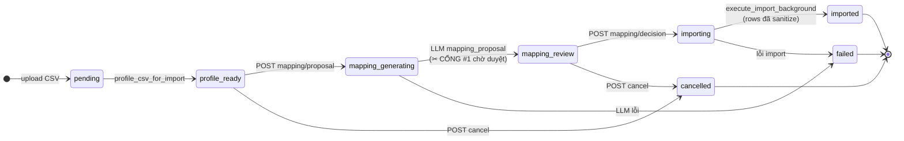
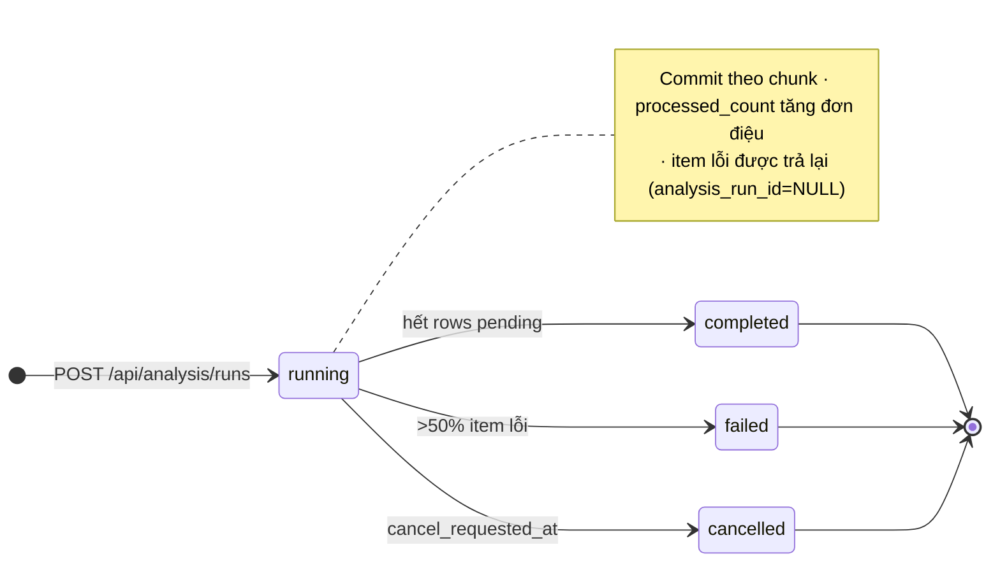
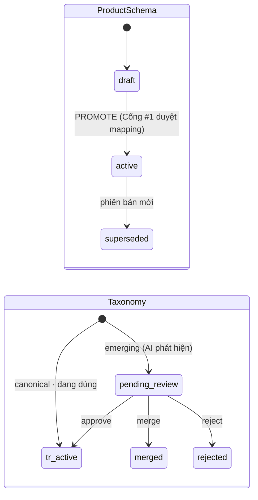
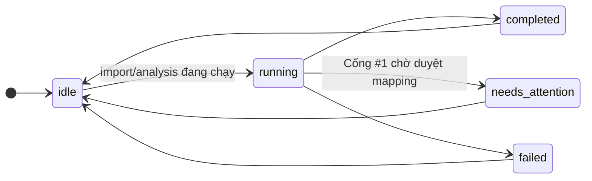

# 5. Sơ đồ máy trạng thái (State Machine)

## 5.1. Graph LangGraph UNDERSTAND — luồng điều khiển

## 5.2. Trạng thái Insight (Cổng #2)

## 5.3. Trạng thái Action (Cổng #3)

## 5.4. Trạng thái Import (Cổng #1)

## 5.5. Trạng thái AnalysisRun

## 5.6. Trạng thái ProductSchema & Taxonomy

## 5.7. Trạng thái phiên làm việc FE (Activity Center)

