# 6. Sơ đồ thực thể — quan hệ (ERD)

Mô hình dữ liệu đầy đủ: 15 bảng ứng dụng (Alembic 0001–0017) + 4 bảng checkpoint LangGraph (ngoài Alembic).

```mermaid
erDiagram
    users ||--o{ insight_reviews : "reviewer_id"
    users ||--o{ decision_logs : "reviewer_id"
    products ||--o{ imports : "product_id"
    products ||--o{ feedback : "product_id"
    products ||--o{ taxonomies : "product_id"
    taxonomies ||--o{ taxonomies : "parent_id (cây tự tham chiếu)"
    products ||--o{ product_schemas : "product_id"
    products ||--o{ insights : "product_id"
    products ||--o{ evidence : "product_id"
    products ||--o{ decision_logs : "product_id"
    imports ||--o{ feedback : "import_id"
    imports ||--o{ analysis_runs : "import_id"
    analysis_runs ||--o{ feedback : "analysis_run_id"
    analysis_runs ||--o{ evidence : "run_id"
    analysis_runs ||--o{ llm_call_logs : "analysis_run_id"
    analysis_runs ||--o{ insights : "run_id"
    clusters ||--o{ feedback : "cluster_id (NULL = noise)"
    insights ||--o{ actions : "CASCADE"
    insights ||--o{ insight_reviews : "CASCADE"
    insights ||--o{ impact_checks : "CASCADE"
    actions ||--o{ impact_checks : "CASCADE"

    users {
        uuid id PK
        varchar_320 email UK "NOT NULL"
        text password_hash "Argon2 (pwdlib)"
        timestamptz created_at
    }

    products {
        uuid id PK
        varchar_200 name UK "workspace"
        text description
        int taxonomy_version "tăng khi apply taxonomy mới"
        timestamptz created_at
    }

    imports {
        uuid id PK
        uuid product_id FK
        varchar_100 source_type "csv | manual | api"
        text storage_path "storage/imports (disk)"
        varchar_50 mapping_version
        int schema_version
        import_status_enum status "pending…imported"
        int row_count
        int source_row_count
        jsonb column_profiles
        jsonb mapping_proposal "chờ Cổng #1"
        jsonb report "FE poll"
        text error
        timestamptz created_at
    }

    feedback {
        uuid id PK
        uuid product_id FK
        uuid import_id FK "nullable"
        varchar_100 source
        varchar_255 source_record_id
        timestamptz occurred_at "thời điểm sự kiện"
        timestamptz imported_at
        text raw_content "RANH GIỚI PII — không bao giờ ra ngoài"
        text feedback_text "đã sanitize"
        bool pii_detected
        jsonb pii_entities
        jsonb data "chiều phân tích sản phẩm"
        jsonb source_meta
        jsonb ai_analysis "NULL = chưa enrich"
        vector_1536 embedding "pgvector"
        varchar_100 embedding_model
        int embedding_dim
        uuid analysis_run_id FK
        uuid cluster_id FK
        timestamptz created_at
    }

    analysis_runs {
        uuid id PK
        varchar_50 pipeline_version "v3 | understand-v1"
        varchar_100 llm_model "snapshot"
        varchar_20 prompt_version
        varchar_100 embedding_model "snapshot"
        uuid import_id FK "nullable"
        varchar_20 mode
        int chunk_size "default 1"
        run_status status "running|completed|failed|cancelled"
        int processed_count
        int total_count
        int failed_count
        timestamptz cancel_requested_at
        timestamptz started_at
        timestamptz completed_at
        text error
    }

    llm_call_logs {
        uuid id PK
        uuid analysis_run_id FK "nullable"
        uuid feedback_id "ref trần, KHÔNG FK (bảo vệ dữ liệu lịch sử)"
        llm_call_type call_type "classify|embed|name_cluster|schema_map|plan|evaluate|synthesize|act_generate|enrich|taxonomy_generate|topic_recommend|route|critic|generate_insight"
        varchar_20 prompt_version
        varchar_100 model
        int latency_ms
        int prompt_tokens
        int completion_tokens
        text error "chỉ metadata — không bao giờ lưu nội dung prompt/response"
        timestamptz created_at
    }

    clusters {
        uuid id PK
        varchar_255 name "LLM naming"
        text summary
        int feedback_count
        int current_count
        int previous_count
        timestamptz first_seen
        timestamptz last_seen
        float growth_ratio "cap 9.99"
        bool is_emerging
        bool is_spike
        float suggested_priority
    }

    taxonomies {
        uuid id PK
        uuid product_id FK
        uuid parent_id FK "cây phân loại"
        varchar_100 name "unique per product"
        varchar_200 slug "unique khi not null"
        text description
        varchar_20 kind "canonical | emerging"
        varchar_20 status "active|pending_review|merged|rejected"
        int evidence_count
        timestamptz first_seen
        timestamptz last_seen
        timestamptz created_at
    }

    product_schemas {
        uuid id PK
        uuid product_id FK
        int version "UK (product_id, version)"
        jsonb definition "fields: key, label, description, type"
        varchar_20 status "draft → active → superseded"
        timestamptz created_at
    }

    evidence {
        uuid id PK
        uuid run_id FK
        uuid product_id FK
        varchar_50 type "tool_result…"
        text statement
        jsonb payload
        float coverage
        varchar_50 source_tool
        timestamptz created_at
    }

    insights {
        uuid id PK
        uuid product_id FK
        uuid run_id FK "nullable"
        varchar_255 title
        text finding
        float finding_confidence "độ tin cậy SỰ THẬT"
        jsonb hypothesis "statement + confidence — suy luận, tách khỏi fact"
        jsonb affected_context
        jsonb impact
        jsonb limitations
        jsonb evidence "danh sách evidence_id — whitelist"
        varchar_20 status "pending|approved|edited|rejected|investigating"
        vector_1536 embedding
        varchar_100 embedding_model
        int embedding_dim
        timestamptz created_at
    }

    insight_reviews {
        uuid id PK
        uuid insight_id FK "ondelete CASCADE"
        jsonb original_value
        jsonb edited_value
        insight_review_action action "approve|edit|investigate_more|reject"
        text reason
        uuid reviewer_id FK
        timestamptz created_at
    }

    actions {
        uuid id PK
        uuid insight_id FK "ondelete CASCADE"
        business_function function "8 giá trị"
        text recommendation
        text rationale
        jsonb decision_support "bất biến — snapshot AI"
        int impact "AI ước lượng"
        int effort
        int urgency
        float confidence
        float priority_score "công thức tất định, không phải LLM"
        int human_impact "override Cổng #3"
        int human_effort
        int human_urgency
        text override_reason
        varchar_20 status "proposed|edited|accepted|rejected"
        timestamptz created_at
    }

    decision_logs {
        uuid id PK
        uuid product_id FK
        decision_subject subject_type "schema_mapping|taxonomy|insight|action"
        uuid subject_id "đa hình, không FK"
        jsonb agent_value
        jsonb human_value
        text reason
        uuid reviewer_id FK
        timestamptz created_at
    }

    impact_checks {
        uuid id PK
        uuid action_id FK "ondelete CASCADE"
        uuid insight_id FK "ondelete CASCADE"
        timestamptz checked_at
        int window_days
        int before_count
        int after_count
        float delta_ratio "KPI vòng lặp đóng"
        timestamptz created_at
    }

    checkpoints {
        text thread_id PK "= analysis_runs.id của run"
        text checkpoint_ns PK
        text checkpoint_id PK
        text parent_checkpoint_id
        text type
        jsonb checkpoint
        jsonb metadata
    }

    checkpoint_blobs {
        text thread_id PK
        text checkpoint_ns PK
        text channel PK
        text version PK
        text type
        bytea blob
    }

    checkpoint_writes {
        text thread_id PK
        text checkpoint_ns PK
        text checkpoint_id PK
        text task_id PK
        int idx PK
        text channel
        text type
        bytea blob
    }
```

## Ghi chú thiết kế

- **`raw_content` vs `feedback_text`:** cặp cột thể hiện ranh giới PII — bản sanitize được tạo một lần và dùng cho mọi truy vấn/prompt/response.
- **`ai_analysis` NULLable:** chính là "đánh dấu đã xử lý" của pipeline — batch picker chỉ lấy row có `analysis_run_id IS NULL`.
- **`embedding_model` + `embedding_dim` theo từng row:** chống trộn vector giữa các model/dimension khác nhau khi đổi model embedding.
- **Không ANN index:** dataset ≤ 1500 dòng → quét chính xác `<=>` cosine là đủ và tất định (quyết định v1.1 trong `docs/decisions.md`).
- **4 bảng checkpoint** (`checkpoints`, `checkpoint_blobs`, `checkpoint_writes`, `checkpoint_migrations`) do `AsyncPostgresSaver.setup()` tạo lúc khởi động, bị loại khỏi Alembic bằng filter `include_object`.
- **`decision_logs` đa hình:** `subject_type` + `subject_id` (không FK) để ghi lại quyết định từ cả 4 nguồn: mapping, taxonomy, insight, action.
