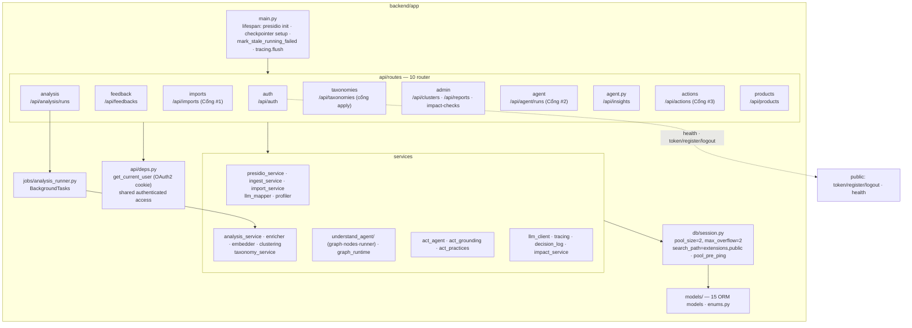
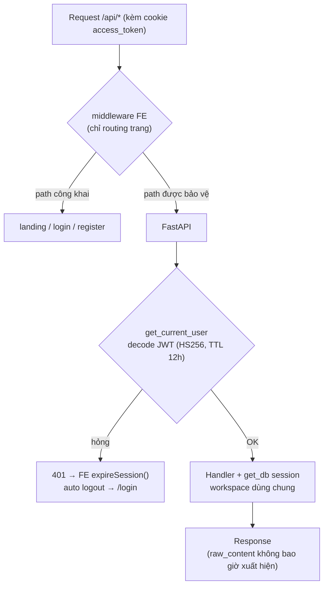
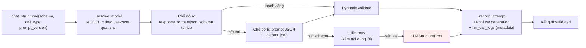

# 7. Sơ đồ module API & xác thực

## 7.1. Tổ chức module API (package diagram)

## 7.2. Ma trận endpoint × xác thực (45+ endpoint, tất cả đã production)

| Nhóm | Endpoint đại diện | Method | Xác thực |
|---|---|---|---|
| Health | `/api/health` | GET | công khai |
| Auth | `/api/auth/token` · `/register` · `/logout` · `/me` | POST/GET | công khai (login) / user |
| Products | `/api/products` | GET/POST | cookie/Bearer |
| Products | `/api/products/{id}` | PATCH/DELETE | cookie/Bearer |
| Feedback | `/api/feedbacks` (+ `/similar`) | GET/POST | cookie/Bearer |
| Feedback | `/api/feedbacks/{id}` · `/bulk-delete` | PATCH/DELETE | cookie/Bearer |
| Imports (Cổng #1) | `/api/imports/**` (mapping proposal/decision, cancel) | POST/GET | cookie/Bearer |
| Imports | `/api/imports/{id}` | DELETE | cookie/Bearer |
| Analysis | `/api/analysis/runs/**` · `/re-enrich-uncategorized` | POST/GET | cookie/Bearer |
| Taxonomies | `/api/taxonomies/generate` · `/recommend` (tốn phí LLM) | POST | cookie/Bearer |
| Taxonomies | `/api/taxonomies/apply` · `/review/{id}` | POST | cookie/Bearer (cổng con người) |
| Agent (Cổng #2) | `/api/agent/runs/**` (+trace, decision) | POST/GET | cookie/Bearer |
| Insights | `/api/insights` | GET | cookie/Bearer |
| Insights | `/api/insights/{id}` | PATCH/DELETE | cookie/Bearer |
| Actions (Cổng #3) | `/api/insights/{id}/actions/**` · `/api/actions/{id}` | POST/GET/PATCH | cookie/Bearer |
| Clusters/Reports | `/api/clusters` · `/api/reports/summary` · `/api/reports/kpis` | GET/POST | cookie/Bearer |
| Impact | `/api/impact-checks/run` | POST | cookie/Bearer |

Quy ước lỗi chuẩn: `401` hết hạn/không đăng nhập · `404` không tồn tại · `409` xung đột trạng thái · `422` schema sai · `500` lỗi hệ thống.

## 7.3. Luồng xác thực theo request

## 7.4. Chuỗi gọi LLM có cấu trúc (structured output pipeline)

> Mỗi lần gọi ghi **cả hai** lớp trace (kể cả lần thất bại); Langfuse nhận input đã sanitize (≤2000 ký tự), `llm_call_logs` chỉ nhận metadata.
