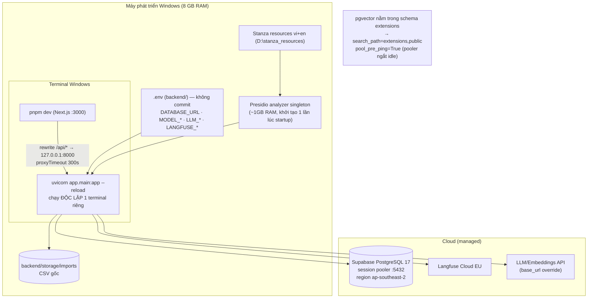
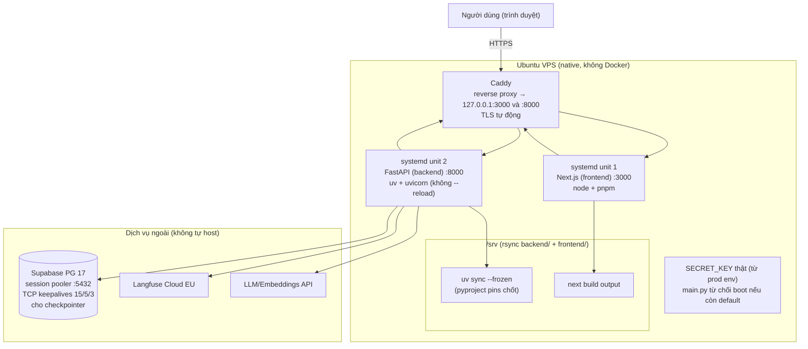
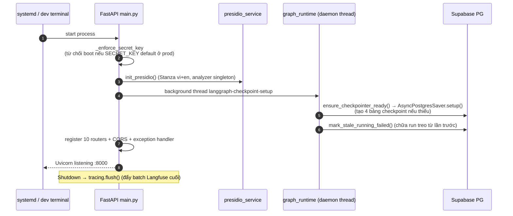

# 8. Sơ đồ triển khai (Deployment)

> Quy tắc cứng: **không dùng Docker trong mọi môi trường**. Dev = FastAPI native trên Windows; Prod = Ubuntu VPS + systemd + Caddy.

## 8.1. Môi trường phát triển (dev — Windows)

## 8.2. Môi trường sản xuất (prod — Ubuntu VPS)

Các bước deploy (`infra/setup_vps.sh`): `apt install python3.12 uv caddy` → tạo user hệ thống non-login → `rsync backend/` → `uv sync --frozen` → copy unit files `infra/systemd/` → `systemctl enable --now` → Caddy reverse proxy + TLS.

## 8.3. Khởi động ứng dụng (lifespan sequence)

## 8.4. Rủi ro vận hành & biện pháp (từ thực tế dev)

| Rủi ro | Biện pháp thiết kế |
|---|---|
| Pooler Supabase ngắt kết nối idle | `pool_pre_ping=True`; TCP keepalives (15/5/3) cho checkpointer; pool nhỏ 2+2 |
| pgvector type không resolve | `search_path=extensions,public` trong connect args |
| LLM chạy lâu vượt proxy | `proxyTimeout: 300_000` ở Next; graph chạy background thread + FE polling |
| Run treo do server restart giữa chừng | trạng thái graph persist trong checkpoint tables + `mark_stale_running_failed` lúc startup |
| Supabase free tier tự pause (7 ngày) | chạy ≥1 query mỗi tuần |
| Windows + `--reload` spawn subprocess | uvicorn chạy terminal riêng; background work dùng BackgroundTasks/daemon thread, không Celery |
