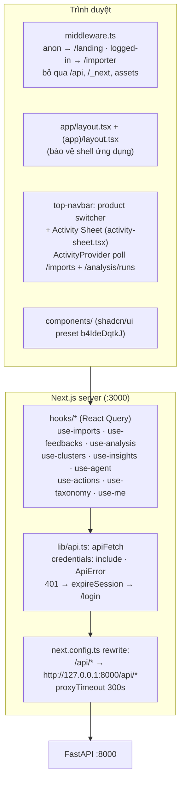
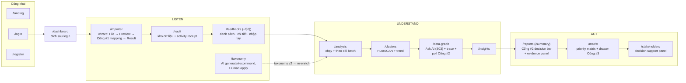
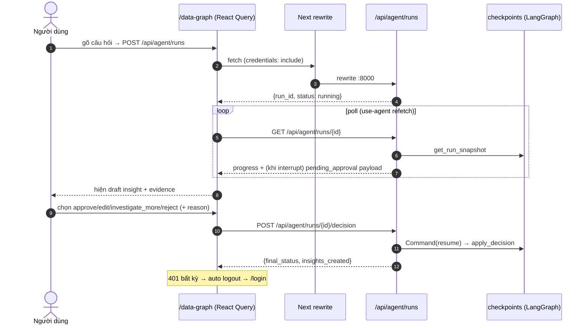

# 9. Kiến trúc Frontend (Next.js App Router)

## 9.1. Sơ đồ thành phần frontend

## 9.2. Bản đồ trang ↔ chức năng ↔ endpoint

## 9.3. Ánh xạ hook ↔ endpoint (React Query)

| Hook / UI | Endpoint BE | Trang |
|---|---|---|
| `use-me` · account-menu · login/register | `POST /api/auth/token` · `/register` · `/logout` · `GET /me` | login, register, navbar |
| `top-navbar` (product switcher) | `GET/POST /api/products` · `PATCH/DELETE /api/products/{id}` | mọi trang (app shell) |
| `use-imports` | `POST /api/imports` · `GET /imports/{id}` (+`/preview`, `/mapping`) · `POST .../mapping/proposal` · `POST .../mapping/decision` · `POST /cancel` · `DELETE` | **/importer** (Cổng #1) |
| `use-feedbacks` · data-entry-dialog | `GET/POST /api/feedbacks` · `GET/PATCH/DELETE /{id}` · `POST /bulk-delete` · `GET /{id}/similar` | /feedbacks, /vault |
| `use-analysis` | `POST /analysis/runs/preview` · `POST /runs` · `GET /runs` · `GET /runs/{id}` · `POST /runs/{id}/cancel` | /analysis, /vault |
| `use-taxonomy` | `POST /taxonomies/generate` · `/apply` · `/recommend` · `/recommend/apply` · `POST /analysis/re-enrich-uncategorized` | /taxonomy |
| `use-clusters` | `GET /api/clusters?sort=…` · `POST /api/clusters/run` | /clusters |
| `use-insights` · `use-reports` | `GET /api/insights` · `PATCH/DELETE /insights/{id}` · `GET /reports/summary?days=7\|30\|90` | /insights, /reports |
| `use-agent` | `POST /agent/runs` · `GET /runs/{id}` (pending_approval + progress) · `GET /trace` · `POST /runs/{id}/decision` | /data-graph, /reports (Cổng #2) |
| `use-actions` | `POST /insights/{id}/actions/generate` · `GET /insights/{id}/actions` · `POST /insights/{id}/actions` · `PATCH /actions/{id}` | /matrix, /stakeholders (Cổng #3) |

Chưa nối FE (chỉ Swagger): `/api/health`, `/api/products/{id}`, schema endpoints, `GET/POST /api/taxonomies` (+`/review`), `GET /api/reports/kpis`, `POST /api/impact-checks/run`.

## 9.4. Trình tự tương tác FE với Cổng #2 (polling + interrupt)

