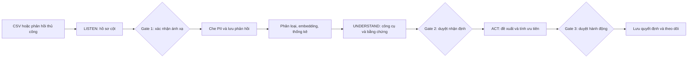
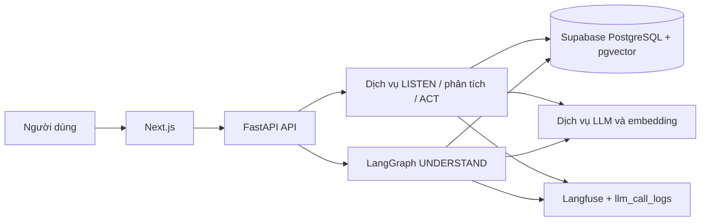
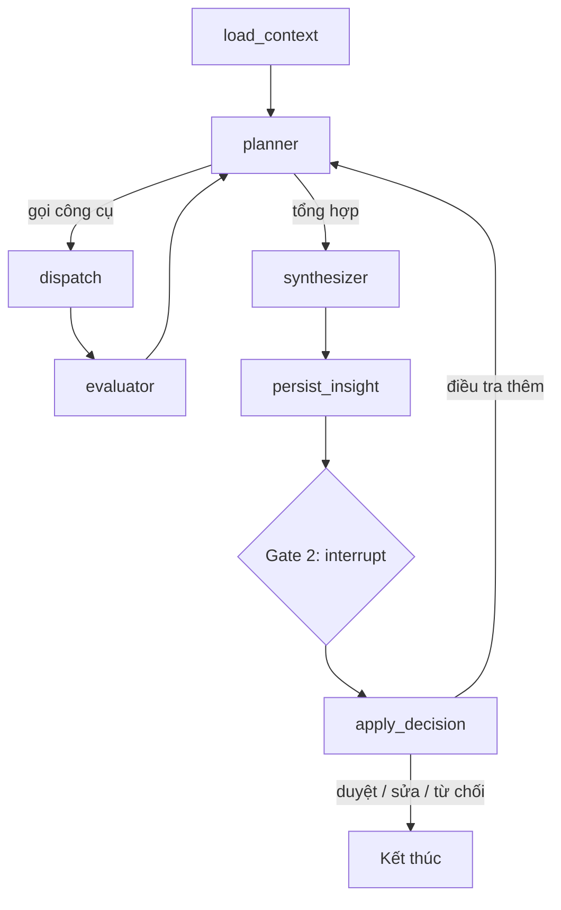
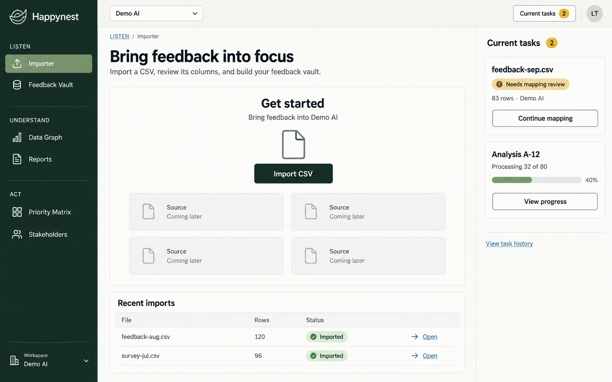
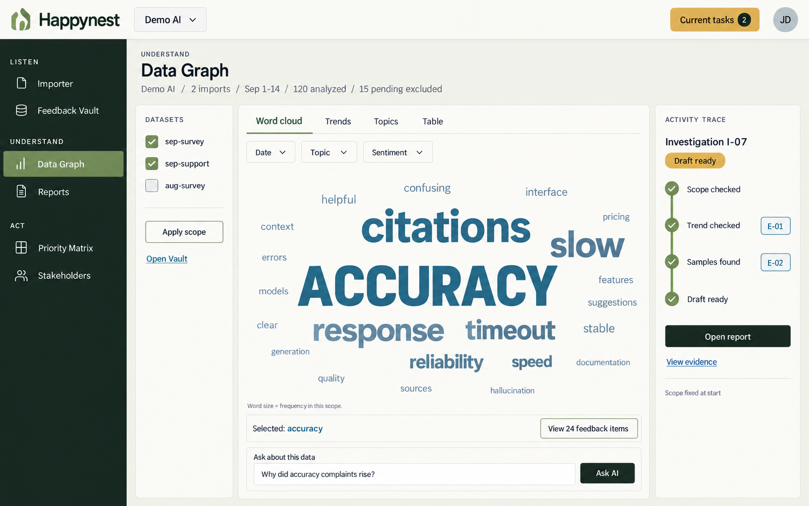
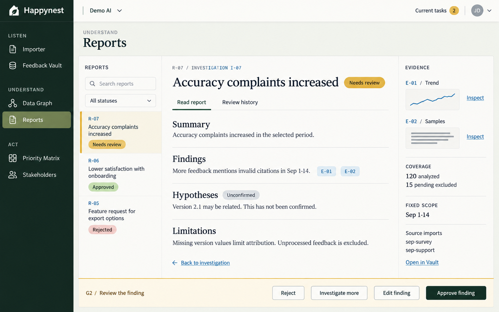
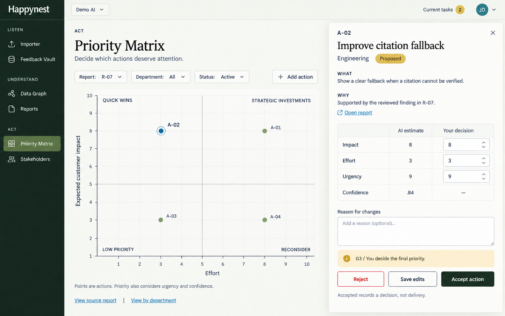
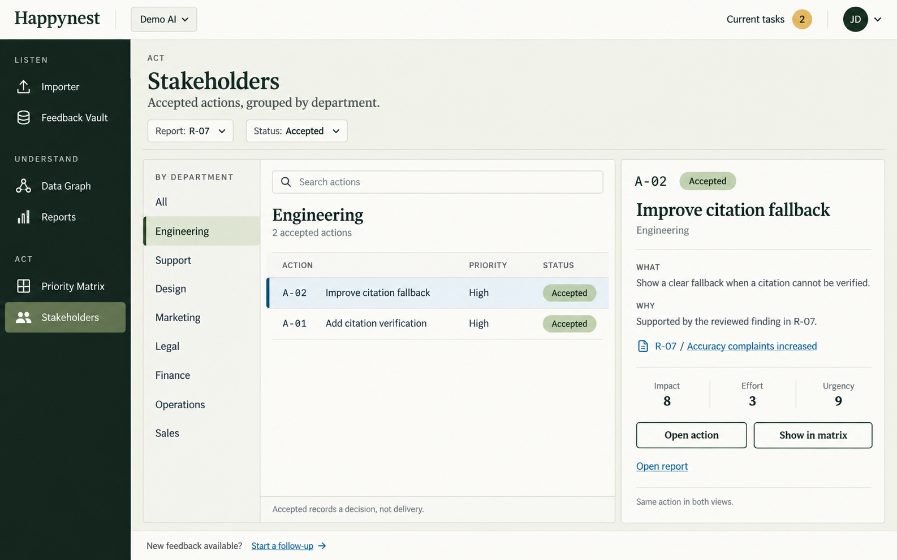

# CHƯƠNG 3. PHÂN TÍCH VÀ THIẾT KẾ HỆ THỐNG

## 3.1. Phân tích quy trình nghiệp vụ

### 3.1.1. Tác nhân và trách nhiệm

Hệ thống phục vụ hai vai trò đăng nhập: người quản lý sản phẩm (`pm`) và nhân sự vận hành (`operations`). Người quản lý sản phẩm theo dõi tình hình, xác nhận nhận định và quyết định công việc ưu tiên. Nhân sự vận hành tiếp nhận, tổ chức và kiểm tra dữ liệu cùng các trạng thái xử lý được API cho phép. Một số thao tác có thể gây mất dữ liệu hoặc thay đổi nội dung đã duyệt chỉ dành cho `pm`. Phân quyền cụ thể được đặt tại API chứ không chỉ ẩn nút trên giao diện.

Nhà cung cấp mô hình ngôn ngữ là hệ thống ngoài có nhiệm vụ trả lời lời gọi phân loại, ánh xạ, điều tra và đề xuất hành động. Supabase lưu dữ liệu quan hệ và vector. Langfuse nhận thông tin trace được phép ghi. Tệp CSV là nguồn dữ liệu đầu vào do người dùng tải lên. Các thành phần này không phải người ra quyết định cuối: việc một mô hình đề xuất ánh xạ hay hành động không chuyển quyền sở hữu quyết định từ người dùng sang dịch vụ ngoài.

Ba giai đoạn chính được nối bởi một chuỗi đối tượng dữ liệu. LISTEN tạo bản ghi import, phiên bản schema và phản hồi đã che thông tin. Bước phân tích gắn nhãn và embedding với phản hồi. UNDERSTAND tạo run, evidence và insight. ACT liên kết insight đã duyệt với các action và log quyết định. Product là đơn vị tổ chức dữ liệu; hầu hết truy vấn phân tích phải xác định product đang xét. Sơ đồ tổng thể cần thể hiện rõ các ranh giới này, vì một hình chỉ có mũi tên “AI xử lý dữ liệu” sẽ không nói được điểm nào tạo ra bằng chứng và điểm nào chờ con người.

### 3.1.2. Quy trình xử lý chính

Ở lượt sử dụng đầu tiên, người dùng đăng nhập và chọn hoặc tạo product. Họ tải lên tệp CSV; hệ thống đọc cấu trúc và chuẩn bị bản xem trước đã che thông tin, chưa tiêu thụ lượt gọi AI mapping. Khi người dùng yêu cầu đề xuất ánh xạ, ứng dụng nêu chi phí dự kiến và tạo một công việc nền. Sau khi nhận đề xuất, người dùng xác nhận, sửa hoặc xử lý cột mơ hồ tại Gate 1. Chỉ khi quyết định hợp lệ, từng dòng phản hồi mới được đưa vào cơ sở dữ liệu với nội dung đã che.

Ở bước phân tích, người dùng chọn một import và phạm vi phản hồi chưa xử lý. Hệ thống lập bản xem trước về số mục, lượt gọi logic và phạm vi chi phí; yêu cầu xác nhận trước khi bắt đầu. Runner lấy đúng tập đã chọn, gọi phân loại và embedding, cập nhật tiến trình theo lô. Kết quả có thể xem ở Feedback Vault, Data Graph, danh sách tương tự hoặc các báo cáo tổng hợp. Việc phân cụm là bước riêng; không có cụm vẫn phải xem được phản hồi và số liệu cơ bản.

Khi người dùng hỏi một câu về sản phẩm, UNDERSTAND tạo run điều tra. Agent đọc schema, taxonomy, độ phủ và các dữ kiện nền, chọn công cụ phù hợp rồi ghi lại kết quả thành evidence. Sau khi đánh giá mức đủ và mâu thuẫn của bằng chứng, nó tạo một insight nháp. Gate 2 cho phép người dùng duyệt, sửa, từ chối hoặc yêu cầu điều tra tiếp. Chỉ insight phù hợp trạng thái mới được dùng để sinh action. ACT định tuyến tới các nhóm nghiệp vụ liên quan, đưa ra đề xuất và các ước lượng; người dùng thay đổi hoặc chấp nhận ở Gate 3. Quyết định và các giá trị trước/sau được lưu cho báo cáo sau này.

**Hình 3.1. Luồng nghiệp vụ từ phản hồi đến hành động.**

Hình 3.1 là sơ đồ nghiệp vụ của phiên bản đang xây dựng. Nó không hàm ý các giai đoạn chạy hoàn toàn tự động: người dùng có thể dừng sau LISTEN hoặc xem dữ liệu mà chưa tạo insight. Từng Gate kiểm soát một loại rủi ro khác nhau.

## 3.2. Đặc tả yêu cầu hệ thống

### 3.2.1. Yêu cầu chức năng

Yêu cầu chức năng được gắn mã để có thể liên kết với ca sử dụng và kết quả kiểm thử. Nhóm tiếp nhận bảo đảm dữ liệu chỉ được nhập sau khi người dùng thấy cách hệ thống hiểu cột. Nhóm phân tích tạo khả năng tìm và tổng hợp phản hồi. Nhóm điều tra chuyển dữ liệu đã xử lý thành nhận định có thể kiểm tra. Nhóm quyết định giúp người dùng xem, điều chỉnh và lưu hành động. Những thao tác bổ trợ như đăng nhập, chọn product và xem tiến trình là điều kiện để các luồng chính hoạt động.

**Bảng 3.1. Yêu cầu chức năng chính**

| Mã | Yêu cầu | Kết quả quan sát được |
|---|---|---|
| F01 | Đăng nhập và giới hạn thao tác theo vai trò | API trả 401/403 đúng tình huống |
| F02 | Tạo, chọn và quản lý product | Dữ liệu được gắn product |
| F03 | Tải CSV, xem hồ sơ cột và bản xem trước | Bản xem trước không lộ phản hồi thô |
| F04 | Đề xuất, sửa và xác nhận ánh xạ | Import hoàn tất sau Gate 1 |
| F05 | Phân tích phạm vi phản hồi đã chọn | Run có tiến trình và kết quả |
| F06 | Tìm phản hồi, xem tương tự và khám phá chủ đề | Danh sách và số liệu có thể truy về phản hồi |
| F07 | Hỏi Agent và xem bằng chứng của nhận định | Run, evidence và insight liên kết |
| F08 | Duyệt hoặc yêu cầu điều tra thêm | Gate 2 lưu trạng thái và quyết định |
| F09 | Tạo, chỉnh sửa và duyệt hành động | Gate 3 giữ giá trị AI và người dùng |
| F10 | Xem báo cáo tổng hợp và KPI | Số liệu có kỳ đo, mẫu số phù hợp |

Bảng 3.1 là bản rút gọn cho nội dung chính. Danh sách endpoint và các lỗi chi tiết được đưa vào phụ lục để tránh biến chương thiết kế thành bản sao Swagger. Tại thời điểm viết, những màn hình cũ ngoài luồng sáu màn hình chính vẫn còn trong mã nguồn; chúng không làm thay đổi định nghĩa F03–F09 của quy trình đề tài.

### 3.2.2. Yêu cầu phi chức năng

**Bảng 3.2. Yêu cầu phi chức năng và cơ chế thiết kế**

| Mã | Yêu cầu | Cơ chế trong thiết kế |
|---|---|---|
| N01 | Bảo vệ thông tin định danh | Che PII trước prompt, response và trace |
| N02 | Truy vết nhận định | Lưu evidence, run và lịch sử duyệt |
| N03 | Giới hạn chi phí AI | Bước trả phí tường minh, phạm vi phân tích và ngân sách run |
| N04 | Chịu lỗi dịch vụ ngoài | Kiểm tra cấu trúc, thử lại có giới hạn, báo lỗi rõ |
| N05 | Tránh xử lý trùng | Trạng thái run, claim và thao tác idempotent |
| N06 | Có thể sử dụng trên máy phát triển | Chạy native, xử lý nền, quy mô dữ liệu có giới hạn |

Các cơ chế trong Bảng 3.2 là lựa chọn kiến trúc. Mức đáp ứng thực tế, ví dụ kết quả kiểm thử PII hoặc thời gian chạy, được trình bày ở Chương 4. Yêu cầu N01 không thể được chứng minh chỉ bằng một đoạn mã gọi Presidio; cần kiểm tra ranh giới API và dữ liệu trace. N03 cũng không thể được coi là hoàn thành chỉ vì có dòng chữ báo chi phí trên giao diện; API phải ngăn phân tích ngoài phạm vi đã xác nhận.

## 3.3. Ca sử dụng và hành vi hệ thống

### 3.3.1. Ca sử dụng tổng quát

Hai tác nhân `pm` và `operations` cùng tham gia nhiều ca sử dụng đọc và xử lý. Các ca tạo, sửa hoặc xóa có quyền khác nhau, vì thế biểu đồ use case cần thể hiện quan hệ quyền bằng ghi chú hoặc bảng quyền đi kèm. Các ca quan trọng là: đăng nhập; chọn product; tải và xác nhận mapping; phân tích phản hồi; xem dữ liệu; yêu cầu Agent điều tra; duyệt insight; tạo và quản lý action; xem báo cáo. Những ca phụ như xem tiến trình, hủy công việc hoặc tìm phản hồi tương tự là phần mở rộng của luồng chính.

### 3.3.2. Đặc tả ca nhập và xác nhận ánh xạ

Tiền điều kiện là người dùng đã đăng nhập và đã chọn product hợp lệ. Người dùng gửi CSV, hệ thống lưu thông tin import, đọc header và tạo hồ sơ cột. Bản xem trước trả về giá trị mẫu đã che; tại thời điểm này mapping AI chưa chạy. Nếu người dùng chọn xin đề xuất, ứng dụng tạo một công việc nền và thông báo trạng thái. Người dùng xem đề xuất cho từng cột rồi chọn ánh xạ vào trường chuẩn, đưa vào thuộc tính theo product, lưu metadata nguồn hoặc bỏ qua. Cột nội dung bắt buộc phải được ánh xạ đúng một lần; cột mơ hồ không thể được chấp nhận nguyên trạng. Khi quyết định hợp lệ, hệ thống đọc từng dòng, che thông tin định danh, lưu feedback và báo số dòng thành công/thất bại.

Các đường lệch phải được mô tả ngang hàng với đường thành công. Nếu tệp không đọc được, hệ thống dừng trước khi đề xuất. Nếu product đã có import đang chờ review theo chính sách hiện hành, API phản hồi xung đột. Nếu dịch vụ mapping lỗi, trạng thái quay về chỗ người dùng có thể thử lại. Nếu người dùng hủy import hợp lệ, tệp nguồn được xóa trong thư mục lưu trữ đã kiểm tra đường dẫn. Việc thay đổi mapping sau khi đã nhập không tự động sửa tất cả bản ghi cũ; nếu muốn nhập lại cần một quyết định nghiệp vụ riêng.

### 3.3.3. Đặc tả ca phân tích và xem dữ liệu

Người dùng chọn một import và các phản hồi chưa được phân tích. Trước khi bắt đầu, API preview trả số item, hình thức chạy `selected` hoặc `batch` và ước tính số lượt gọi. Yêu cầu tạo run chứa phạm vi đã chọn và số lượng được xác nhận. Nếu một phản hồi đã đổi trạng thái giữa preview và POST, API trả xung đột `selection_changed`; người dùng phải xem lại. Runner đánh dấu các item được xử lý, gọi phân loại và embedding theo phạm vi rồi cập nhật tiến trình. Việc dừng là hợp tác: yêu cầu hủy có hiệu lực tại ranh giới item hoặc chunk, không làm biến mất kết quả đã hoàn thành.

Kết quả có thể được xem theo danh sách, chi tiết hoặc tìm tương tự. Một phản hồi chưa có embedding không thể tìm hàng xóm vector; API thông báo trạng thái chưa sẵn sàng thay vì tạo kết quả rỗng gây hiểu sai. Tên chủ đề mới do mô hình gợi ý đi vào luồng quản trị taxonomy. Khi dữ liệu đủ, người dùng có thể chạy phân cụm; các phản hồi nhiễu vẫn có trong kho dữ liệu và không bị loại khỏi báo cáo tổng thể.

### 3.3.4. Đặc tả ca điều tra và duyệt nhận định

Người dùng đặt câu hỏi gắn với một product. Hệ thống tạo run, nạp thông tin về schema, độ phủ, taxonomy và các cụm nổi bật. Agent chọn một công cụ trong registry và gửi tham số có cấu trúc. Công cụ kiểm tra trường được hỏi, thực hiện truy vấn và trả về quan sát; run ghi evidence gồm nội dung tóm tắt, nguồn công cụ và dữ liệu đi kèm. Agent đánh giá mức đủ, mâu thuẫn và câu hỏi cần làm rõ trước khi tạo insight nháp. Insight gồm tiêu đề, `finding`, độ tin cậy của finding, giả thuyết có thể không có, bối cảnh ảnh hưởng, tác động, giới hạn và danh sách mã bằng chứng.

Gate 2 cho phép người dùng chấp nhận, sửa, từ chối hoặc điều tra thêm. Nếu sửa nội dung chữ, hệ thống phải che lại thông tin định danh trước khi lưu. Nếu điều tra thêm, Agent quay về bước lập kế hoạch; các bằng chứng trước đó không bị mất. Nếu không có đủ bằng chứng, insight chỉ nêu giới hạn và điều hệ thống đã thử. Một mã evidence do mô hình tự bịa không được lưu làm trích dẫn hợp lệ.

### 3.3.5. Đặc tả ca tạo và duyệt hành động

Sau khi nhận định ở trạng thái được chấp nhận, người dùng yêu cầu tạo đề xuất hành động. Mô hình cho điểm mức liên quan đối với các nhóm MARKETING, LEGAL, DESIGN, FINANCE, ENGINEERING, OPERATION, SALES và SUPPORT. Chỉ nhóm vượt ngưỡng cấu hình và có đề xuất hợp lệ mới sinh action. Mô hình đưa ra ước lượng impact, effort, urgency và confidence; hệ thống tính điểm ưu tiên bằng công thức định sẵn. Giao diện ma trận cho người dùng xem các action theo tác động và công sức.

Tại Gate 3, người dùng có thể chấp nhận, sửa ước lượng hoặc từ chối. Trường do AI sinh và trường người dùng chỉnh được lưu riêng; sau chỉnh sửa, điểm ưu tiên được tính lại từ giá trị có hiệu lực. Hệ thống không tự gửi công việc tới Jira, Slack hay các nhóm ngoài ứng dụng. Như vậy, “hành động” trong phạm vi đề tài là một phương án được quản lý và được người dùng quyết định, không phải thay đổi sản phẩm đã tự thực thi.

## 3.4. Thiết kế kiến trúc thành phần

### 3.4.1. Kiến trúc tổng quan

Frontend được xây dựng bằng Next.js với các trang ứng dụng và lớp hook gọi API. Backend FastAPI tập trung các router, schema kiểm tra request/response, dịch vụ nghiệp vụ và mô-đun agent. SQLAlchemy làm việc với PostgreSQL; Alembic quản lý thay đổi lược đồ. pgvector lưu vector phản hồi và nhận định. LangGraph quản lý trạng thái điều tra, sử dụng checkpointer PostgreSQL cho Gate 2. LLM và embedding được gọi qua API tương thích OpenAI, vì vậy nhà cung cấp có thể thay bằng cấu hình mà không đổi toàn bộ dịch vụ. Thông tin phục vụ giám sát chi phí và lỗi được ghi vào `llm_call_logs` và Langfuse.

**Hình 3.2. Kiến trúc thành phần của ứng dụng.**

Hình 3.2 mô tả quan hệ triển khai thử nghiệm. Tệp CSV gốc được lưu ở đĩa cục bộ theo một quyết định đã ghi trong `docs/decisions.md`, còn nội dung đã che đi vào cơ sở dữ liệu và pipeline. Mục tiêu VPS trong tài liệu hạ tầng chưa được coi là môi trường đã chạy; sơ đồ triển khai thực tế phải phản ánh Windows phát triển và Supabase managed PostgreSQL.

### 3.4.2. Hợp đồng API và xử lý nền

Các router được chia theo auth, products, imports, feedback, analysis, taxonomies, agent, actions và báo cáo. Request được kiểm tra bằng Pydantic và quyền được gắn tại router hoặc route theo hành vi. Frontend dùng các mutation/query để gửi lệnh và lấy trạng thái. Với công việc có thể kéo dài, như đề xuất mapping, phân tích phản hồi hoặc điều tra, API trả mã run/import; frontend theo dõi tiến trình qua polling. Thiết kế này giảm khả năng timeout của một lần gọi giao diện, nhưng không biến tiến trình nền trong ứng dụng thành một hàng đợi bền vững như một hệ thống phân tán độc lập. Bản báo cáo cần nêu rõ giới hạn này.

Một số điểm trả phí được tách thành hai bước: preview/receipt và xác nhận. `POST /api/imports` chỉ chuẩn bị profile; request mapping riêng mới gọi mô hình. Analysis có API preview và giới hạn tối đa 100 feedback cho một run. Cách tách này tạo một điểm kiểm soát chi phí có thể kiểm thử, bởi chỉ dựa vào một hộp thoại trên frontend không đủ bảo đảm khi API được gọi trực tiếp.

### 3.4.3. Trạng thái và lỗi có thể phục hồi

Import có các trạng thái từ tạo hồ sơ, sinh đề xuất, chờ duyệt, đang nhập, nhập xong đến thất bại/hủy. Analysis run có trạng thái và bộ đếm processed/total. Agent run có bước đang điều tra, chờ duyệt và hoàn thành hoặc thất bại. Những trạng thái này cho phép giao diện hiển thị đúng việc đang diễn ra và cho phép người dùng quay lại sau khi tải lại trang. Một công việc chạy lại phải kiểm tra dữ liệu đã ghi để không tạo bản ghi trùng. Những ranh giới thao tác có khả năng lặp lại được đánh giá ở Chương 4.

## 3.5. Thiết kế cơ sở dữ liệu

### 3.5.1. Các nhóm thực thể

Nhóm dữ liệu gốc có `products`, `imports`, `feedback`, `product_schemas` và `taxonomies`. Nhóm phân tích có `analysis_runs`, `clusters`, `evidence` và `insights`. Nhóm quyết định có `insight_reviews`, `actions`, `decision_logs` và `impact_checks`. `users` phục vụ xác thực và quyền; `llm_call_logs` ghi metadata gọi mô hình. Quan hệ trọng tâm là một product có nhiều import và feedback; feedback có thể thuộc một import và một run phân tích; evidence được gắn với run điều tra; insight gắn với product và evidence; action gắn với insight. Khóa ngoại và trường trạng thái hiện thực các điều kiện nghiệp vụ tương ứng.

**Bảng 3.3. Vai trò các bảng dữ liệu cốt lõi**

| Bảng | Dữ liệu chính | Ý nghĩa |
|---|---|---|
| `products` | Tên và mô tả sản phẩm | Ranh giới tổ chức dữ liệu |
| `imports` | Tệp, profile, mapping, trạng thái | Lịch sử nhận dữ liệu |
| `feedback` | Nội dung đã che, JSONB, vector | Đơn vị phản hồi để phân tích |
| `product_schemas` | Trường và phiên bản | Cách hiểu thuộc tính của sản phẩm |
| `taxonomies` | Nhãn và trạng thái duyệt | Chuẩn hóa chủ đề |
| `analysis_runs` | Loại run, phạm vi, tiến trình | Theo dõi công việc |
| `evidence` | Kết quả công cụ và nguồn | Căn cứ cho nhận định |
| `insights` | Finding, hypothesis, hạn chế | Báo cáo điều tra |
| `actions` | Đề xuất, ước lượng, trạng thái | Phương án xử lý |
| `decision_logs` | Giá trị AI/người, lý do | Lịch sử quyết định |

Bảng 3.3 chỉ giải thích các bảng trọng tâm; từ điển trường đầy đủ đặt trong phụ lục. Khi vẽ ERD cần lấy migration cuối cùng, không dùng sơ đồ của các pha 17–20 đã bị thay thế. Các bảng checkpoint của LangGraph do cơ chế checkpointer quản lý và được loại khỏi bộ migration nghiệp vụ của Alembic.

### 3.5.2. Cấu trúc bản ghi phản hồi và ranh giới PII

Bảng `feedback` lưu `raw_content` để duy trì nguồn dữ liệu nhưng không trả trường này qua API phản hồi. Dịch vụ che PII tạo `feedback_text`; chỉ trường này được đưa vào phân loại, embedding và ví dụ hiển thị. Metadata các thực thể PII có thể được lưu để kiểm tra loại và vị trí, nhưng không cần chép lại nguyên văn giá trị nhạy cảm. Các thuộc tính nguồn như thời điểm, mã ngoài và tên nguồn được lưu tách biệt để có thể truy vấn đúng thời gian sự kiện.

Ba vùng JSONB có trách nhiệm rõ. `data` chứa các trường phân tích theo product, chẳng hạn phiên bản hay gói dịch vụ nếu nguồn có. `source_meta` chứa thông tin chỉ có ý nghĩa tại nguồn. `ai_analysis` chứa diễn giải do pipeline sinh: topic, severity, sentiment và các thuộc tính tương tự. Sự tách này giúp biết một trường do người dùng cung cấp hay do AI suy ra. Vector phản hồi có kèm tên mô hình và số chiều để tránh trộn các embedding không tương thích.

### 3.5.3. Bằng chứng và quyết định

Mỗi lượt công cụ của UNDERSTAND có thể tạo một bản ghi evidence: ID, product, run, tên công cụ, phát biểu tóm tắt, payload và độ phủ nếu có. Insight lưu danh sách ID evidence để truy ngược. Bảng quyết định ghi `agent_value`, `human_value`, lý do, người duyệt và thời gian. Action cũng giữ cột điểm do AI tạo cùng điểm người dùng override. Dữ liệu này phục vụ kiểm tra sau này: nếu vị trí trên ma trận đổi sau khi sửa impact, có thể giải thích bằng cặp giá trị trước/sau thay vì chỉ thấy kết quả cuối.

Thiết kế có bảng `impact_checks` nhằm đo số phản hồi phù hợp trước và sau mốc một action đã được chấp nhận, theo cửa sổ ngày cấu hình. Đây là một thống kê theo thời gian, không phải phép chứng minh nhân quả rằng action gây ra thay đổi. Một biến động sau hành động còn có thể do phiên bản sản phẩm, mùa vụ, mẫu người dùng hoặc thay đổi kênh thu thập. Báo cáo kết quả phải dùng cách diễn đạt tương ứng.

## 3.6. Thiết kế xử lý AI và Agent

### 3.6.1. Pipeline LISTEN và phân loại

LISTEN tách khâu đọc dữ liệu khỏi khâu gọi mô hình. Profiler chạy xác định trên tệp CSV và tạo mẫu giá trị đã che. LLM mapper chỉ nhận thông tin hồ sơ cột, không nhận tất cả dòng nguyên gốc. Khi người dùng xác nhận Gate 1, bộ nhập ghi từng feedback sau khi gọi sanitizer. Phân tích là công việc riêng: một run được giới hạn theo import, có giới hạn 100 mục và có thể chọn chế độ từng item hoặc lô. Classifier nhận `feedback_text`, taxonomy hiện hành và trả JSON kiểm tra bằng schema. Embedder lưu vector 1536 chiều và metadata mô hình. Đặc tả này làm rõ vì sao “upload” và “phân tích AI” là hai quyết định khác nhau.

### 3.6.2. Công cụ phân tích và query compiler

Agent không truy cập cơ sở dữ liệu bằng SQL tự sinh. Registry công cụ liệt kê tên, mô tả, kiểu tham số và hàm thực thi. Query compiler nhận filter có ngữ nghĩa, so sánh với schema đang hoạt động của product, rồi tạo điều kiện truy vấn SQLAlchemy. Nếu một trường không tồn tại, công cụ trả lỗi quan sát được để Agent sửa kế hoạch hoặc nêu giới hạn. Cơ chế này vừa giảm rủi ro truy vấn sai vừa khiến bằng chứng có thể tái lập với cùng tham số.

Kết quả công cụ cần đủ thông tin để giải thích. Số đếm có phạm vi product và cửa sổ thời gian; phân tích một trường có độ phủ; tìm kiếm ngữ nghĩa có thứ tự và giới hạn số mẫu; ví dụ phản hồi luôn dùng văn bản đã che. Những giới hạn số mẫu và độ dài văn bản đưa vào prompt được cấu hình để tránh một lượt điều tra tiêu tốn quá nhiều token. Giá trị cấu hình tại thời điểm chạy cần được ghi nếu sử dụng kết quả đó trong Chương 4.

### 3.6.3. Graph UNDERSTAND và Gate 2

Graph hiện tại có các node `load_context`, `planner`, `dispatch`, `evaluator`, `synthesizer`, `persist_insight` và `apply_decision`. Sau `load_context`, planner chọn gọi công cụ hay chuyển sang tổng hợp. Dispatch kiểm tra và chạy công cụ, lưu evidence; evaluator đánh giá kết quả rồi trả về planner. Khi đủ điều kiện kết thúc hoặc đạt giới hạn, synthesizer tạo insight nháp. `persist_insight` ghi bản nháp rồi gọi `interrupt()` chờ Gate 2. Khi được tiếp tục, `apply_decision` cập nhật trạng thái; lựa chọn điều tra thêm đưa graph trở lại planner.

**Hình 3.3. Graph điều tra UNDERSTAND và điểm duyệt.**

Hình 3.3 thể hiện graph thực tế hơn là một nhãn chung “Agent tự suy nghĩ”. Từng vòng có dữ liệu đầu vào, kết quả công cụ và dấu vết. Số vòng tối đa và ngân sách gọi mô hình được giới hạn. Finding và hypothesis được giữ tách biệt cả trong trạng thái và nội dung trả về giao diện; khi người dùng chỉnh finding, phần chữ được che lại trước khi lưu.

### 3.6.4. ACT và công thức ưu tiên

Sau Gate 2, dịch vụ ACT đưa insight đã duyệt vào một lượt gọi mô hình để đánh giá mức liên quan của các nhóm nghiệp vụ và tạo ứng viên hành động. Các ứng viên không liên quan được bỏ qua. Với hành động hợp lệ, bốn ước lượng `impact`, `effort`, `urgency` và `confidence` được chuẩn hóa theo miền giá trị đã định. Điểm ưu tiên do backend tính, không yêu cầu mô hình tự cộng điểm. Công thức cấu hình hiện tại là:

**(3.1)** `P = 0,4 × I + 0,3 × U + 0,2 × (10 × C) + 0,1 × (10 − E)`.

Trong đó `I` là tác động, `U` là tính cấp bách, `E` là công sức trên thang 1–10; `C` là độ tin cậy trong khoảng 0–1; `P` là điểm ưu tiên. Trọng số là tham số cấu hình của sản phẩm thử nghiệm, không được khảo sát chứng minh là trọng số tối ưu cho mọi tổ chức. Nếu người dùng sửa `I`, `U` hoặc `E`, hệ thống lấy giá trị được duyệt để tính lại P, nhưng giữ số do AI đề xuất để phục vụ so sánh. Ma trận 2×2 dùng impact và effort để hỗ trợ nhìn nhanh, không thay thế điểm P hoặc quyết định cuối.

## 3.7. Thiết kế giao diện người dùng

### 3.7.1. Hành trình sáu màn hình

Giao diện chính được tổ chức thành sáu màn hình. Importer hướng dẫn chọn file, xem trước, duyệt mapping và xem kết quả nhập. Feedback Vault tập trung danh sách phản hồi, lọc và xem chi tiết, đồng thời bắt đầu phân tích. Data Graph cho phép khám phá chủ đề, xu hướng và hỏi Agent. Reports hiển thị các insight, bằng chứng và Gate 2. Priority Matrix đưa hành động vào bốn vùng tác động–công sức và xử lý Gate 3. Stakeholders giúp xem phương án theo nhóm nghiệp vụ. Thanh điều hướng phân ba giai đoạn để người dùng biết họ đang thao tác trên dữ liệu, nhận định hay hành động.

Thiết kế sáu màn hình theo `docs/design/2026-09-15-ui-flow/` là nguồn cấu trúc cho giao diện. Hình ảnh trong thư mục đó là **ảnh thiết kế**; Chương 4 chỉ gọi một hình là giao diện chạy thật nếu ảnh được chụp từ ứng dụng ở phiên bản kiểm thử. Điều này tránh biến bản mô phỏng thành bằng chứng triển khai. Các route cũ còn tồn tại ngoài thanh điều hướng được xem là di sản chuyển tiếp, không phải thêm sáu giai đoạn mới.

### 3.7.2. Trạng thái và khả năng tiếp tục

Giao diện cần xử lý trường hợp chưa có product, chưa có dữ liệu, upload đang chuẩn bị, mapping chờ duyệt, analysis đang chạy, agent chờ Gate 2, và action chưa được chấp nhận. Những trạng thái này có nội dung và thao tác khác nhau. Ví dụ, khi import ở trạng thái `profile_ready`, giao diện phải cho người dùng chọn bước đề xuất mapping; nó không được giả định upload đã hoàn tất xử lý AI. Khi run đang chờ duyệt, người dùng quay lại Reports và tiếp tục từ đúng run. Lỗi 401, 403, 404, 409 và 422 được giải thích theo tình huống thay vì hiển thị một thông báo chung không thể hành động.

## 3.8. Thiết kế bảo mật, kiểm soát chi phí và vận hành

Yêu cầu bảo vệ dữ liệu tạo ra một ranh giới rõ giữa `raw_content` và `feedback_text`. Lớp nhập dữ liệu là nơi chuyển đổi; lớp phân tích, prompt và API trả về chỉ dùng bản đã che. JWT nằm trong cookie `httpOnly`, `SameSite=Lax`; vai trò được kiểm tra ở backend. Dữ liệu sản phẩm được lọc theo product ID ở các dịch vụ cần phạm vi; tác vụ có chi phí được tạo sau một bước preview hoặc xác nhận. Log mô hình lưu ID, loại gọi, model, token, độ trễ và trạng thái lỗi, không lưu bản văn prompt/response trong bảng metadata.

Khi chạy trên Windows, bộ phân tích PII dùng nhiều bộ nhớ nên được khởi tạo một lần khi ứng dụng bắt đầu. Checkpointer LangGraph dùng PostgreSQL và khởi tạo bất đồng bộ để không giữ bước khởi động API. Cấu trúc này phù hợp với môi trường phát triển đã nêu, nhưng phụ thuộc kết nối tới Supabase và dịch vụ AI. Khi một bên ngoài không sẵn sàng, ứng dụng cần biểu thị trạng thái lỗi hoặc giảm khả năng, thay vì tuyên bố một kết quả phân tích chưa được tạo. Quy trình triển khai production trên VPS chưa hoàn tất và vì vậy không được trình bày như một đặc tính đã được kiểm thử.

## 3.9. Đối chiếu bản thiết kế giao diện với hành trình người dùng

Năm hình sau lấy từ `docs/design/2026-09-15-ui-flow/` và được dùng như bản thiết kế, không phải ảnh chụp kết quả chạy. Chúng làm rõ cách phân chia trách nhiệm giữa các màn hình và vị trí người dùng kiểm soát quá trình. Việc đặt hình thiết kế trong Chương 3 cho phép Chương 4 dành ảnh chụp thật, nếu bổ sung được, để chứng minh triển khai. Mỗi màn hình đều cần đường quay lại dữ liệu gốc hoặc quyết định trước đó, bởi một quy trình phân tích có thể bị dừng tại bất kỳ Gate nào.

**Hình 3.4. Bản thiết kế màn hình Importer cho LISTEN.**

Hình 3.4 nhấn mạnh bước tiếp nhận và lập hồ sơ trước khi đưa tệp vào phân tích. Vùng xem trước giúp người dùng nhận ra cột nội dung, thời gian, nguồn và các cột nghiệp vụ khác. Nút đề xuất ánh xạ cần tách khỏi thao tác tải tệp, bởi lời gọi mô hình có chi phí và mapping có thể sai. Gate 1 phải hiển thị cả các cột chưa ánh xạ và trường hệ thống bắt buộc; nếu thiếu `feedback_text`, không được tiếp tục nhập như một tệp hợp lệ. Kết quả duyệt là một quyết định có thể truy vết theo import và phiên bản schema sản phẩm.

**Hình 3.5. Bản thiết kế màn hình Data Graph cho khám phá và điều tra.**

Data Graph tổ chức cùng một tập phản hồi theo chủ đề, thời gian và câu hỏi. Đồ thị không chỉ có chức năng trang trí: mỗi thành phần thống kê cần giữ bộ lọc tương ứng để mở được danh sách phản hồi nguồn. Khi người dùng đổi sản phẩm hoặc khoảng thời gian, tất cả số liệu phải cùng thay đổi theo phạm vi đó; nếu không, một đồ thị và một bảng có thể đưa ra hai mẫu số khác nhau. Vùng hỏi Agent khởi tạo run điều tra, và kết quả cần có trạng thái đang xử lý, chờ duyệt hoặc hoàn tất thay vì lập tức hiển thị văn bản chưa có bằng chứng.

**Hình 3.6. Bản thiết kế màn hình Reports cho insight và Gate 2.**

Reports phân biệt finding, hypothesis, evidence và giới hạn. Cách phân tách này cho phép người đọc nhận ra câu nào là dữ kiện và câu nào là cách giải thích đang chờ kiểm chứng. Một thao tác duyệt cần lưu người thực hiện, thời điểm, trạng thái cuối và nội dung chỉnh sửa nếu có. Với lựa chọn điều tra thêm, hệ thống phải tiếp tục từ run có checkpoint, đồng thời giữ lịch sử evidence cũ để người dùng thấy vì sao kết luận thay đổi. Không nên tạo một insight mới không liên hệ với câu hỏi ban đầu rồi xóa dấu vết của lần trả lời trước.

**Hình 3.7. Bản thiết kế Priority Matrix cho ACT và Gate 3.**

Ma trận đặt impact và effort trên hai trục để nhìn nhanh các phương án. Vị trí của một action phải tính bằng giá trị có hiệu lực: nếu người dùng đã sửa impact hoặc effort, đồ thị phản ánh giá trị sau sửa, còn giá trị mô hình ban đầu vẫn tồn tại để đối chiếu. Ngưỡng chia bốn vùng là quy ước hỗ trợ đọc, không thay thế điểm ưu tiên có trọng số. Người dùng có thể chấp nhận, sửa hoặc bỏ một đề xuất; ứng dụng không thực hiện thay công việc của nhóm sản phẩm, kỹ thuật hoặc pháp chế.

**Hình 3.8. Bản thiết kế màn hình Stakeholders theo nhóm nghiệp vụ.**

Màn hình Stakeholders nhóm action theo chức năng để giải thích vì sao một insight liên quan hoặc không liên quan đến từng bộ phận. ACT có tập chức năng cố định trong phiên bản hiện tại: Marketing, Legal, Design, Finance, Engineering, Operation, Sales và Support. Từng chức năng nhận một mức relevance; đề xuất dưới ngưỡng có thể bị bỏ qua. Đây là bộ khung chuyển giao thông tin, không phải lời hứa rằng mỗi insight phải sinh đủ tám việc. Người duyệt có quyền bỏ đề xuất không phù hợp bối cảnh tổ chức.

## 3.10. Hợp đồng dữ liệu và vòng đời của ba Gate

### 3.10.1. Gate 1: cấu trúc đầu vào và schema sản phẩm

Một CSV từ kênh khảo sát có thể dùng `Answer` cho nội dung, trong khi tệp hỗ trợ khách hàng dùng `Message`; cùng tên `Date` cũng có thể là thời điểm gửi hoặc thời điểm đóng phiếu. Vì vậy, việc nối tên cột trực tiếp với bảng `feedback` là không an toàn về ngữ nghĩa. LISTEN tạo một hồ sơ gồm tên cột, kiểu suy đoán, tỷ lệ rỗng và ví dụ đã che. Từ hồ sơ này, LLM đề xuất mapping, nhưng kết quả chỉ là ứng viên. Người dùng sửa hoặc xác nhận ánh xạ tại Gate 1, rồi hệ thống mới chuyển các dòng sang cấu trúc chuẩn và lưu định nghĩa schema của product.

`schema_registry.py` phân biệt bốn trường lõi với trường mở rộng. `feedback_text` là nội dung đã che và bắt buộc; `occurred_at` giữ thời gian nghiệp vụ; `source` chỉ kênh xuất phát; `source_record_id` hỗ trợ nhận diện dòng nguồn. Bốn khóa này không nằm trong `definition` của schema do người dùng thêm, nhằm tránh một sản phẩm đổi nghĩa chúng. Trường mở rộng có thể thuộc các kiểu category, numeric, datetime, text hoặc boolean. Trước khi lưu phiên bản mới, registry từ chối khóa trùng, kiểu không hợp lệ và khóa xung đột với trường lõi. Phiên bản đang dùng là `active`; phiên bản cũ chuyển sang `superseded`, giúp diễn giải vì sao hai đợt nhập cùng sản phẩm có thể có cấu trúc hơi khác.

Không phải mọi cột gốc đều cần đẩy vào prompt. Cột định danh cá nhân hoặc văn bản tự do khác có thể mang dữ liệu nhạy cảm; preview chỉ cung cấp mẫu an toàn. Với một cột không ánh xạ, hệ thống cần cho người dùng thấy trạng thái bỏ qua, không lén gán vào trường có tên gần giống. Với trường thời gian không phân tích được, cần lưu lỗi hoặc trạng thái thiếu để báo cáo xu hướng biết loại trừ. Việc ghi lại mapping đã duyệt cũng có ý nghĩa tái lập: khi tính lại một thống kê từ cùng import, phải biết cột nào đã tạo `occurred_at` và `source`.

**Bảng 3.4. Hợp đồng tối thiểu của dữ liệu phản hồi sau Gate 1**

| Thành phần | Nguồn | Điều kiện kiểm tra | Vai trò sau nhập |
|---|---|---|---|
| `feedback_text` | Cột văn bản đã duyệt | Có nội dung, đã che PII | Phân loại, embedding, evidence |
| `occurred_at` | Cột thời gian nếu có | Kiểu ngày/giờ hợp lệ | Tính xu hướng theo thời gian |
| `source` | Cột nguồn hoặc giá trị xác nhận | Chuẩn hóa thành chuỗi | Lọc theo kênh |
| `source_record_id` | ID dòng nguồn nếu có | Ổn định trong cùng nguồn | Chống nhập trùng |
| `data` | Trường mở rộng được duyệt | Khớp phiên bản schema | Bộ lọc theo product |
| `ai_analysis` | Pipeline phân tích | JSON có cấu trúc hợp lệ | Chủ đề, sentiment, severity |

Bảng 3.4 tách nguồn tạo từng thuộc tính khỏi vai trò của nó ở giai đoạn sau. Các điều kiện kiểm tra được áp dụng trước khi một thuộc tính trở thành đầu vào cho Agent hoặc báo cáo.

### 3.10.2. Gate 2: nhận định và căn cứ

Gate 2 có đối tượng khác Gate 1: đầu vào của nó là một run điều tra, tập evidence và một insight nháp. Graph UNDERSTAND có các bước `load_context`, `planner`, `dispatch`, `evaluator`, `synthesizer`, `persist_insight` và `interrupt`. Planner được xem schema, taxonomy và mức phủ để đặt câu hỏi phù hợp. `dispatch` gọi công cụ trên phạm vi product. `evaluator` xét số liệu có đủ và có mâu thuẫn không; graph có thể quay lại planner trong ngân sách giới hạn. `synthesizer` viết finding và hypothesis riêng, `persist_insight` ghi liên kết với evidence. Interrupt nhường quyền cho người dùng trước khi tiếp tục.

Quyết định ở Gate 2 có bốn hướng nghiệp vụ: duyệt, sửa rồi duyệt, từ chối, hoặc yêu cầu điều tra thêm. Mỗi hướng phải tạo trạng thái có thể phân biệt trong API và giao diện. Nếu người dùng sửa nội dung finding, bản sửa là một đầu vào mới và cần qua ranh giới che PII trước khi lưu hay đưa vào lượt điều tra sau. Nếu người dùng yêu cầu làm rõ, checkpoint cho phép tiếp tục quá trình hiện có thay vì dựng lại bối cảnh bằng tay. Việc duyệt không xóa hypothesis hoặc limitations: một finding có đủ căn cứ để hành động vẫn có thể mang giả thuyết chưa chắc chắn.

`query_compiler.py` giới hạn lớp công cụ phân tích ở các bộ lọc đã định nghĩa. Agent gửi yêu cầu ngữ nghĩa như tên trường và giá trị; compiler đối chiếu với schema `active`, `source`, `topic`, `severity` và `sentiment` rồi tạo điều kiện SQLAlchemy. Khóa lạ gây lỗi có kiểu `UnknownFieldError` để agent biết yêu cầu không hợp lệ. LLM không được viết SQL tự do. Cách này đồng thời giảm rủi ro truy vấn ngoài phạm vi product và giúp người dùng đối chiếu bộ lọc của evidence với schema hiện tại. Nếu schema thay đổi sau một run, cần giữ phiên bản schema gắn với run khi tái kiểm chứng.

### 3.10.3. Gate 3: đề xuất, ghi đè và quyết định

ACT nhận insight đã qua Gate 2, không tự đọc phản hồi thô. Dịch vụ đánh giá mức relevance cho tám nhóm nghiệp vụ và tạo candidate action cho nhóm đạt ngưỡng. Mỗi candidate có recommendation, rationale, impact, effort, urgency và confidence. Pydantic giới hạn miền của các ước lượng; một giá trị ngoài miền bị từ chối trước khi tính ưu tiên. Điểm `priority_score` do hàm backend tính từ bốn giá trị hiệu lực. Thiết kế này ngăn việc mô hình diễn giải công thức không nhất quán giữa hai lượt gọi.

Khi người dùng chỉnh impact, effort hoặc urgency, các cột `human_*` giữ giá trị mới, còn ước lượng ban đầu của Agent tiếp tục tồn tại. Hàm `effective_scores` ưu tiên giá trị con người khi có, rồi `recompute_priority` cập nhật điểm. Việc lưu hai lớp giá trị cho phép báo cáo tỷ lệ người dùng chỉnh đề xuất và nghiên cứu sai lệch có hệ thống về sau. Hành động được chấp nhận không bị một lần sinh lại đề xuất ghi đè; `generate_actions` chỉ thay các action còn ở trạng thái proposed và chưa có tác động của người dùng. Quy tắc idempotency này quan trọng trong môi trường request có thể được gửi lại hoặc run được mở lại.

Gate 3 không đồng nghĩa hệ thống tự thực hiện action. Ứng dụng chỉ hỗ trợ sắp xếp, ghi nhận lựa chọn và theo dõi. Một đề xuất liên quan đến pháp chế hoặc kỹ thuật cần được bộ phận tương ứng đánh giá theo quy trình của tổ chức. Do đó, trạng thái accepted có nghĩa đã chấp nhận phương án trong hệ thống, không có nghĩa thay đổi sản phẩm đã triển khai. Khi tính tác động sau hành động, cần có sự kiện hoàn thành hoặc thời điểm can thiệp thật; chỉ dùng ngày accepted có thể làm sai cửa sổ phân tích.

## 3.11. Thiết kế kiểm soát lỗi và tính nhất quán

Các trạng thái dài của pipeline không phù hợp với một transaction bao phủ toàn bộ quá trình. Upload và lập hồ sơ cột là việc ngắn; gọi mô hình, tạo embedding và điều tra có thể mất nhiều giây hoặc phút. Vì vậy, hệ thống lưu trạng thái từng chặng và để runner xử lý nền. Bản ghi run ghi phạm vi, tiến độ và lỗi, cho phép giao diện hiển thị kết quả hiện thời mà không chờ một request HTTP dài. Đổi trạng thái từ `pending` sang `running`, rồi `completed` hoặc `failed` phải bảo đảm không có hai worker cùng nhận một việc khi retry.

Khi một bước gọi dịch vụ ngoài thất bại, không được tạo kết quả giả. Ví dụ, LLM trả JSON sai cấu trúc sẽ đi qua chuỗi fallback và một lần thử lại đã định; nếu vẫn sai, run lưu lỗi rõ ràng. Nếu embedding chưa tạo, phản hồi vẫn có thể tồn tại để xem và lọc, nhưng tìm tương tự phải báo chưa sẵn sàng. Nếu graph dừng tại Gate 2, trạng thái chờ duyệt khác với trạng thái lỗi. Phân biệt ba trường hợp hoàn tất, chờ người dùng và thất bại giúp người vận hành biết thao tác tiếp theo.

Schema sản phẩm cần cập nhật theo phiên bản trong một giao dịch: chuyển bản cũ sang superseded và tạo bản active mới. Nếu chỉ một bước thành công, một product có thể không có schema active hoặc có hai bản active, làm bộ lọc kết quả không ổn định. Tương tự, khi ACT sinh lại action, việc bảo toàn action đã được sửa hay chấp nhận phải xảy ra cùng transaction với việc thêm candidate mới. Những quy tắc này được đưa vào dịch vụ nghiệp vụ thay vì để giao diện tự ghép nhiều request tạo ra trạng thái nửa vời.

API trả 401 khi chưa có phiên đăng nhập, 403 khi vai trò không được phép, 404 khi ID không thuộc phạm vi có thể tìm thấy, 409 khi trạng thái hiện tại không cho phép thao tác và 422 khi dữ liệu gửi lên sai cấu trúc. Giao diện cần diễn giải theo công việc. Chẳng hạn, 409 ở Gate 2 có thể nghĩa insight đã được một quyết định khác xử lý; người dùng cần tải lại trạng thái trước khi gửi tiếp. 422 trong mapping cần chỉ ra cột thiếu hoặc kiểu không khớp, không dùng một lỗi chung “không thể nhập”. Với lỗi dịch vụ AI, người dùng cần biết dữ liệu đã được lưu đến đâu và có thể thử lại bước nào mà không tạo bản sao.

Thông báo lỗi cũng là một phần của ranh giới PII. Exception từ thư viện hoặc provider có thể chứa payload request; không nên đưa nguyên văn vào giao diện hoặc log không kiểm soát. Tracing giữ thông tin vận hành như loại call, model, token và độ trễ, còn nội dung phản hồi gửi ra ngoài phải là bản đã che. Nếu phát hiện một ca che thiếu, ưu tiên là chặn gọi mô hình và đưa ra trạng thái cần kiểm tra thủ công. Một hệ thống xử lý phản hồi người dùng phải đặt tính đúng của ranh giới này cao hơn việc cố hoàn tất run bằng mọi giá.

## 3.12. Truy vết dữ liệu từ phản hồi tới quyết định

Một yêu cầu quan trọng của hệ thống là người dùng có thể đi ngược từ một đề xuất hành động về những phản hồi đã góp phần tạo ra nó. Chuỗi quan hệ bắt đầu từ `products` và `imports`, qua `feedback`, `analysis_runs`, `evidence`, `insights`, `actions` và `decision_logs`. Tại mỗi bước, ID của đối tượng nguồn cần tồn tại trong dữ liệu hoặc metadata của đối tượng đích. Nếu một insight chỉ lưu một đoạn văn mô tả mà mất danh sách evidence, đường đi bị đứt. Nếu action chỉ lưu recommendation mà không gắn insight, người duyệt không thể biết vì sao phương án được sinh. Việc thiết kế khóa liên kết là một đóng góp thực tế của ứng dụng, không chỉ là yêu cầu trình bày báo cáo.

Một ví dụ giả lập có thể minh họa: ba phản hồi đã che nói rằng tính năng trả lời không nhớ ngữ cảnh sau khi mở lại phiên; bộ lọc chọn đúng product và khoảng thời gian; công cụ trả số lượng cùng ID phản hồi. Agent ghi finding “có ba phản hồi tương ứng trong phạm vi đã chọn”. Nó có thể nêu hypothesis “trạng thái phiên chưa được khôi phục”, nhưng câu sau không phải điều công cụ đếm đã chứng minh. Người dùng tại Gate 2 đọc ba phản hồi, chỉnh finding nếu một câu nói về vấn đề khác, rồi duyệt. ACT đề xuất nhóm Engineering kiểm tra lưu trạng thái và Support chuẩn bị hướng dẫn tạm thời. Hai action phải dẫn về insight đã duyệt và decision log ghi giá trị người dùng thay đổi. Ví dụ này là kịch bản thiết kế, không phải số liệu thực nghiệm của sản phẩm.

Truy vết cũng cần chiều thời gian. Một insight tạo ngày hôm nay có thể dùng taxonomy và schema khác tuần sau. Nếu mở lại insight, giao diện nên hiển thị ngữ cảnh lúc tạo và trạng thái hiện nay. Báo cáo KPI về tỷ lệ duyệt Gate 2 cần chọn một tập run có cùng cửa sổ và định nghĩa trạng thái; không đếm insight bị tạo lại như người dùng đã duyệt hai lần nếu thực tế chỉ một quyết định. Khi một action được chỉnh nhiều lần, decision log là lịch sử, còn bảng action thể hiện giá trị hiệu lực hiện tại. Phân biệt dữ liệu sự kiện với trạng thái mới nhất giúp các bảng báo cáo không tự mâu thuẫn.

**Bảng 3.5. Khóa truy vết và câu hỏi kiểm tra tương ứng**

| Liên kết | Câu hỏi người dùng có thể đặt | Rủi ro nếu thiếu |
|---|---|---|
| Import → Feedback | Dòng này đến từ lần nhập nào? | Không xử lý được nhập trùng |
| Feedback → Analysis run | Kết quả AI thuộc lần phân tích nào? | Không đối chiếu model/prompt |
| Run → Evidence | Con số này tính từ bộ lọc nào? | Nhận định không kiểm chứng được |
| Evidence → Insight | Câu finding dựa trên nguồn nào? | Lẫn dữ kiện với suy đoán |
| Insight → Action | Vì sao bộ phận này nhận đề xuất? | Hành động rời ngữ cảnh |
| Action → Decision log | Ai sửa và chấp nhận giá trị nào? | Không đánh giá được vai trò người dùng |

Bảng 3.5 cho thấy khóa truy vết không chỉ phục vụ lập trình quan hệ mà còn trả lời các câu hỏi kiểm tra của người dùng cuối. Mất một mắt xích làm cho phương án hành động khó giải thích dù văn bản đề xuất vẫn đọc được.

## 3.13. Thiết kế cấu hình và khả năng thay thế dịch vụ AI

Đề tài dùng API tương thích OpenAI với `base_url` cấu hình qua môi trường. Điều này cho phép thử một provider khác mà không đổi toàn bộ code gọi mô hình, nhưng không có nghĩa các provider tương đương về chất lượng, hỗ trợ JSON schema, tokenization hoặc chính sách dữ liệu. Lớp `llm_client` là nơi chuẩn hóa yêu cầu `temperature=0`, xử lý structured output, ghi lỗi và trace. Khi chế độ `response_format` kiểu JSON Schema không được hỗ trợ, ứng dụng chuyển sang prompt yêu cầu JSON, validate bằng Pydantic rồi thử lại một lần nếu cần. Fallback giữ ứng dụng có thể tiếp tục nhưng có thể tăng số request, độ trễ và chi phí; kết quả đánh giá phải ghi provider và đường thực thi đã dùng.

Embedding cũng cần lưu tên mô hình và số chiều với từng vector. Nếu đổi mô hình, hai vector có cùng số chiều chưa chắc ở cùng không gian ý nghĩa; so độ tương đồng giữa chúng có thể sai dù phép toán SQL hợp lệ. Vì vậy, truy vấn tìm tương tự cần chọn các bản ghi tương thích `embedding_model` và `embedding_dim`, hoặc phải chạy lại embedding cho dữ liệu cũ. Giới hạn dữ liệu khóa luận cho phép tránh chỉ mục ANN và dùng truy vấn chính xác ở phạm vi nhỏ; nếu khối lượng tăng, cần đo độ trễ và xem lại chiến lược chỉ mục, không thêm chỉ mục chỉ vì nó thường xuất hiện trong một kiến trúc vector.

Cấu hình có thể điều chỉnh như ngưỡng relevance ACT, trọng số ưu tiên, số vòng agent, giới hạn công cụ và kích thước lô phân tích phải có giá trị mặc định được kiểm tra. Nếu một trọng số bị đổi giữa hai action, báo cáo so điểm trực tiếp có thể mất ý nghĩa; nên lưu hoặc trình bày phiên bản cấu hình dùng lúc tính. Trong bản thử nghiệm hiện tại, một số thông số ở biến môi trường và kết quả hiện tại được lưu trong bản ghi action. Đây là đủ để minh họa logic sản phẩm, nhưng đánh giá dài hạn sẽ cần lịch sử cấu hình chặt hơn. Việc chỉ rõ khoảng trống đó tránh diễn giải một điểm ưu tiên như thước đo khách quan vượt thời gian.
